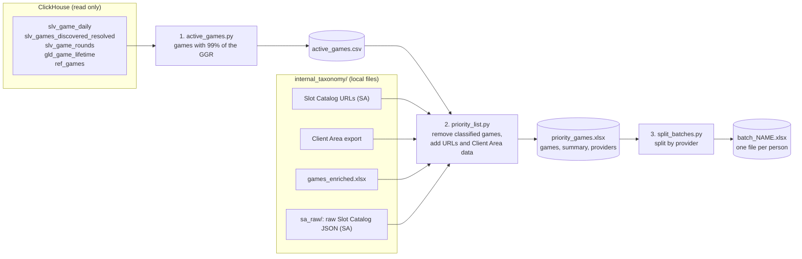

# Game catalog V0: priority list of games to label

I find the games that make 99% of the GGR of the last 6 months, remove the ones already classified, and give the
rest as an Excel list, split by provider for the three people who label.

At the time of writing (2026-10-28): 3,720 highly active games, 769 already classified, **2,951 in the list**.

## Pipeline



```bash
.venv/bin/python catalog_project/active_games.py      # ClickHouse, slow
.venv/bin/python catalog_project/priority_list.py     # local, seconds
.venv/bin/python catalog_project/split_batches.py     # local
.venv/bin/python -m pytest catalog_project/tests -q   # 13 tests, no ClickHouse needed
```

If only a local input changes (URL file, Client Area, `games_enriched`), run the last two scripts only.
`audit_ref_games.py` is a separate check: it prints the freshness of the catalog and how well the activity joins to it.

## Decisions

| Decision | Why |
|---|---|
| **The metric is GGR** (wagered minus won, real money and bonus, EUR), not rounds | The boss asked for it |
| **99% cut:** sort by GGR, then rounds; keep games until the running total reaches 99% of the positive GGR. The game that crosses the limit stays. GGR of 0 or below never enters | The smallest set that covers the activity. The other 16,000 games hold about 1% |
| **Join activity to catalog by normalised id** (lower case, letters and digits only) **and provider, through `slv_games_discovered_resolved`** | The catalog and the activity write ids differently (`coinstrike` and `coin_strike`). Without this, 30% of the rounds did not match. Now 99.9995% do. One id can also belong to two providers |
| **The list is every active game not in `games_enriched.xlsx`**, even if it already has a URL or a game type | `games_enriched` is the file of games SA already classified. `enrichment_status` of `ref_games` is not used to filter, because it only says what the pipeline has |
| **URL:** the Slot Catalog file first, then the Client Area `External Resource` if it is a Slot Catalog link. `sc_url_source` says which | SA has checked its file. The Client Area is a fallback |
| **The raw Slot Catalog JSON of SA add columns at the end** (`sc_*`: features, themes, tags, RTP, volatility, paylines, description...). The old columns do not change | They keep the multiple mechanics and the tags that the summary Excel files dropped. Only games with a URL from the SA file have a JSON (925 of the list). `slotcatalog_json.py` reads them. They join through the UUID that `game_slotcatalog_urls.xlsx` gives to each game |
| **Sports games stay in the list** with `is_sports = true` (providers BETTECH and DIGITAIN_SPORTBOOK) | They hold a large share of the GGR but have no Slot Catalog page. The boss decides how to label them |
| **Players:** lifetime from `gld_game_lifetime`; 30 and 90 days from `slv_game_rounds`, one query per tenant | A 6 month query hit the 300 s limit. A player belongs to one tenant, so the sum is exact. The 30 day figure of `gld_game_signals_daily` is a sum of daily players, not distinct players |
| **Launch date:** `release_date`, else `first_seen` (both from `ref_games`), else `sc_release_date` (raw JSON). The placeholder `2022-01-01` and a `first_seen` on the first day of data (`2025-04-01`) are ignored. If no source has a real date, the days stay empty | 1,812 games share the placeholder. A wrong number is worse than an empty one. The JSON date fills 709 of the 1,085 empty values of the list |
| **Split by provider, balanced by number of games** | Each person works on whole providers and nobody overlaps. The GGR per batch is uneven |
| **`true` and `false` are written as text** | Excel in Spanish would show VERDADERO and FALSO |

## Inputs and outputs

- **ClickHouse** (`whizdomai_org_gmntc_medallion`): `slv_game_daily`, `slv_games_discovered_resolved`, `slv_game_rounds`,
  `gld_game_lifetime`, `ref_games`. Queries are in `sql/`.
- **Local files** in `internal_taxonomy/`: Slot Catalog URLs (SA), Client Area export, `games_enriched.xlsx`, and the folder
  `sa_raw/` with the raw Slot Catalog JSON (one file per game; ignored by git).
- **Outputs** in `output/` (ignored by git): `active_games.csv`, `priority_games.xlsx`, `batch_<name>.xlsx`.
- **Settings** (paths, `months`, `coverage`, sports providers, batch names) are in `config.yaml`.

The `sc_*` columns come from the raw JSON. `sc_title` is the web page title, so it has extra text: use `game_name` as the name.
The `ca_*` columns come from the Client Area. They are a starting point to autocomplete, and they are not checked.

## Open points

- `games_enriched.xlsx` has 1,071 games. About 2,200 more are `enriched` in `ref_games` but not in that file, so the
  list treats them as not classified. The boss has to confirm that `games_enriched` is the full list of classified games.
- `gld_game_unique_players` is empty (checked 2026-10-28). The gold layer needs a check after the node 3 outage.
- `days_since_launch` is empty for about 45% of the games. A real launch date would have to come from SA.
- A few games have more 90 day players than lifetime players (for example `baccarat`, VIVO). The difference is small and
  does not change the list.
- Check the spelling of the batch names in `splits` of `config.yaml` before sharing the files.

`PROGRESS.md` has the day by day log, `DATA_FLOW.md` how the data moves from the client area to the catalog, and
`PLAN.md` the original plan.

## Master catalog (Whizdom Game ID)

`master.ipynb` builds the master list of games with `master_lib.py` (tests in `tests/test_master_lib.py`). It starts
from the games of ref_games seen since January 2025 (`last_seen`, `master_seen_since` in `config.yaml`), with every
column, and joins all the data of the other sources to them:

- **Sources and prefixes:** `ref_` ref_games (`sql/ref_games_master.sql`, all columns), `ca_` Client Area, `sa_` Slot
  Catalog URL file of SA, `sc_` raw Slot Catalog JSON (all fields, also `pros_cons`, `how_to_play` and
  `bonuses_features`), `ge_` games_enriched. The Client Area, the SA file and games_enriched are joined by game id and
  platform; the JSON by the UUID of the SA file, else by name + provider. Columns with no prefix are made by the notebook.
- **A game is its name + provider**, and the provider is the **studio** that made it (not the platform). The studio
  comes from `studios` of ref_games, then the Client Area (often the distributor), then the raw JSON; if none is known,
  the platform is used and `studio_source = platform`.
- **Order of the catalog:** the same as `active_games.py`: GGR of the last 6 months (highest first), then rounds, then
  `game_uid`. `ggr_eur_6m` and `rounds_6m` come from `output/active_games.csv` (`master_ggr` in `config.yaml`, the frozen list
  of 2026-10-28) and are the sum of all the `game_uid` of the game. The first rows are the 99% list, already sorted; the
  games with no GGR go after, by provider and name.
- **Sports betting** has no name in any source: `explicit_names` of `config.yaml` gives the six games a name on purpose
  (`name_source = explicit`), `providers.yaml` maps the GT Sports feeds to `betby` and `digitain`, and `is_sports` marks
  them. Any other game with no name in any source has no ID (sheet `no name`, with its GGR).
- **Name:** `ref_games` first; if it is empty, the Client Area, the SA file or games_enriched (`name_source`). The Client
  Area name is not first because it is sometimes more generic (`Curse of the Pharaoh` for `... Bonus Buy`). `ref_games`
  loses apostrophes (`Santa S Gifts`): `fix_possessive` puts them back.
- **Studio from the same name:** a game takes the provider of the same game name from a better source (ref_games, then
  Client Area, then JSON, then platform) if that source has one provider for the name and the RTP is the same
  (`studio_source = same_name`). Generic names (`European Roulette`) belong to several studios, so a different RTP is a
  different game. This joins, for example, ORYX (distributor) and Gamomat (studio) into one game.
- **Rebranding dictionary:** `providers.yaml` maps every spelling of a provider to one standard name. A person adds names
  to it; the notebook only proposes groups that look alike.
- **Whizdom Game ID:** `uuid5(NAMESPACE, "<provider slug>/<game slug>")`, with a fixed namespace in the code. The same
  game and provider always give the same ID. A game with no name gets no ID (sheet `no name`): an ID from the platform
  id would tie the catalog to the old ids. **Provider ID:** `uuid5(NAMESPACE, "<provider slug>")` (sheet `providers`).
- **No old ids:** the catalog leaves out the ids of platforms, brands and sources (game_uid, game_id, core ids, launch
  and start ids, the UUID of SA...). `game_identities.parquet` keeps the link from each game_uid to its Whizdom Game ID,
  to join the activity. A change in `slugify()` or in `providers.yaml` can change IDs, so every run
  compares them with the last one (sheet `id changes`).
- **Flags:** `match_status` (exact, review, no_match against the raw JSON), `no_url`, `missing_data`,
  `provider_check` (the provider has a look-alike name not merged in `providers.yaml`), `id_shared` and
  `same_platform_conflict` (one game with two game_uid on the same platform, so far always the same game).
  `status` and `rtp` are ref_games, else the Client Area.
- **Final file:** `output/master/master_catalog.xlsx`. Sheets: `read me`, `catalog` (one row per Whizdom Game ID, every
  column of every source except the old ids; a game on several platforms shows the row with the best match), `columns`
  (source and meaning of each column, from `master_columns.yaml` and `columns.yaml`), `providers` (Provider ID, names
  seen, games), `flags`, `review` (only `match_status = review`) and `no name`. Columns that are empty in every row are left out. The IDs that changed against the last run are counted in `read me`.
- **Other outputs** in `output/master/`: `master_games.parquet` (the catalog), `game_identities.parquet` (every
  game_uid and its ID) and `raw_sources.parquet` (every raw JSON, whole, also the games that are not in ref_games).
- Cells marked MANUAL read ClickHouse or S3. The notebook needs `output/master/ref_games.parquet`: run the MANUAL cell
  once to export it. The final file of Navid is pending (`navid_final` in `config.yaml`).
