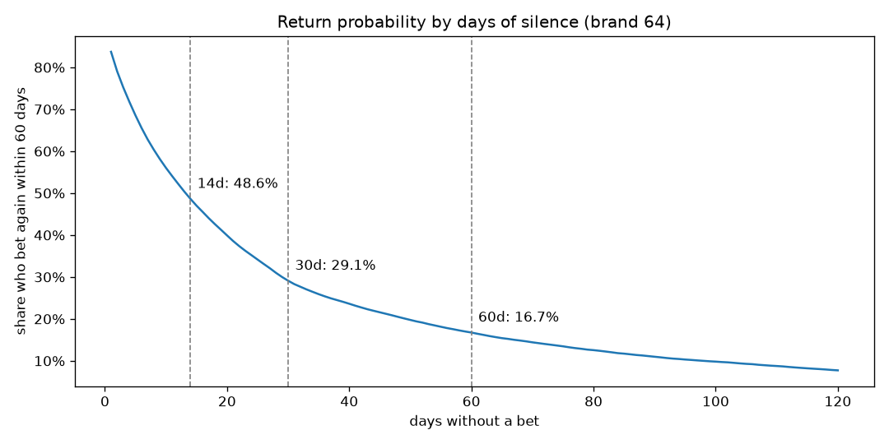
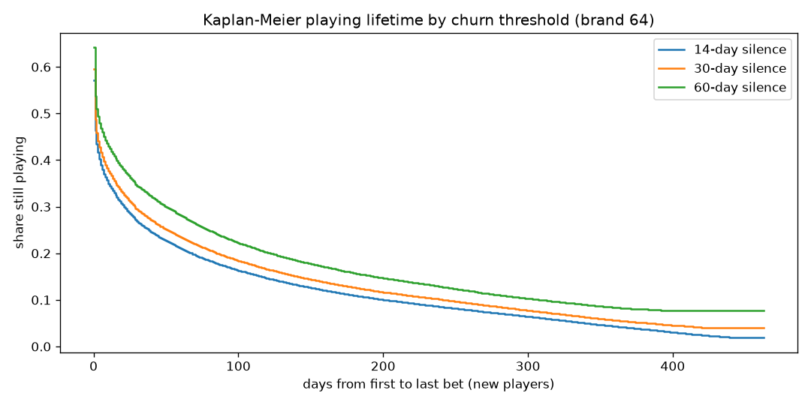
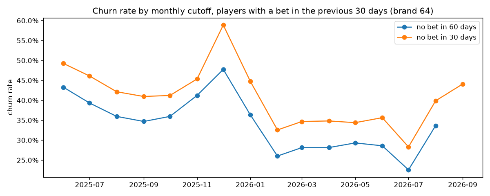

# Baseline Churn Definition v0 (brandId=64)

## 0. Data

The S3 data lake (`org/40-gold`), with **18 months of history** (2025-04-01 to 2026-10-06), long enough to observe returns after long silences.

Notebook: `eda/02_churn_definition.ipynb`. Tables and figures: `data/03_output/churn_definition/brand64/`.

## 1. Summary and Core Definition

A player has **churned** when **60 days pass without an active day**. An active day is a day on which the player staked a non-zero amount from real money or released bonus funds; stakes only from playable bonus funds do not count, because playable funds become released only when the bonus conditions are met (this is how the variable definitions of the gold data model define it). Until 2026-10-15 the pipeline counted a bet from any wallet; all the figures below were recomputed on 2026-10-16 with the official active day.

- After 60 days of silence, **16.7%** of players have an active day again within the next 60 days (12.3% for all brands). After 30 days of silence it would be 29.1%: more than one "churned" player in four would come back.
- Going further than 60 days still gains something: 11.0% come back after 90 days of silence. Each extra month of waiting removes 12.4 points from 30 to 60 days and 5.7 points from 60 to 90 days.
- The churn rate of the active population moves between **22.6% and 47.8%** from one monthly cutoff to the next, with clear seasons.
- **Compared with the any-wallet definition, the threshold is weaker**: the false churn at 60 days goes from 13.0% to 16.7% for brand 64. A likely reason: some players pause real-money play while they still use bonus funds, and these pauses now count as silences, but many of these players come back to real money later. I keep 60 days (section 5), but the choice is less clear than before.

## 2. Activity Data

I build player activity from `gld_player_gaming_daily`: one row per player, game, provider, day and currency with play that day. `src/features/daily_cache.py` (`activity` cache) sums it to one row per player and day with at least one bet, with a column `active` for the active days. I read only the active days (`active_only=True`), filtered to `brandId = 64`: 76,288 players and 1,452,031 active player-days. I use this table rather than `gld_player_signals_daily` because it carries `brand_id` on every row; `signals_daily` has no `brand_id` before July 2026 (see `docs/dq_reports/`). Days are UTC days, as in every source table.

The cache is local and incremental, and it re-reads the last 7 days on every run, because the source reprocesses its last 7 days daily.

## 3. Evidence

### Return probability by days of silence

A silence is a run of days with no active day. For each number of silent days `d`: the share of players who have an active day again within the next 60 days. Only silences that reached day `d` at least 60 days before the end of the data count, so every value has the same chance to see a return (the "fair" rate).

| Days of silence | Brand 64 | All brands |
|---|---|---|
| 7 | 62.8% | 51.6% |
| 14 | 48.6% | 37.0% |
| 30 | 29.1% | 21.4% |
| **60** | **16.7%** | **12.3%** |
| 90 | 11.0% | 8.2% |
| 120 | 7.7% | 5.3% |



The curve has no sharp plateau, but it flattens: 30 more days of silence remove 12.4 points from 30 to 60 days, 5.7 points from 60 to 90 and 3.3 points from 90 to 120.

### Return after dormancy, raw

Every silence that reached the threshold, with any later return (up to 18 months of follow-up); a silence still running counts as no return.

| Threshold | Silences | Returned | Still dormant | Return rate (raw) | Return rate (fair, 60 days) |
|---|---|---|---|---|---|
| 14 days | 163,348 | 95,222 | 68,126 | 58.3% | 48.6% |
| 30 days | 109,493 | 44,955 | 64,538 | 41.1% | 29.1% |
| 60 days | 82,562 | 23,159 | 59,403 | 28.1% | 16.7% |

The raw rates are higher because a return can come months later. The fair rate is the one that matches how the label is used.

### Kaplan-Meier: playing lifetime of new players

New players (first active day after 2025-06-30, so that the first active day is really the first): 41,390. Lifetime = days from the first to the last active day; churn confirmed when the silence after the last active day reaches the threshold.

| Threshold | Confirmed churns | Censored | Median lifetime |
|---|---|---|---|
| 14 days | 37,283 | 9.9% | 1 day |
| 30 days | 34,829 | 15.9% | 1 day |
| 60 days | 30,800 | 25.6% | 3 days |



About half of the new players stop within one to three days of their first active day.

### Churn rate by monthly cutoff

Players with an active day in the 30 days up to the cutoff (the population of the features), and the share with no active day in the next 30 and 60 days.

| Cutoff | Players | No active day in 30 days | No active day in 60 days |
|---|---|---|---|
| 2025-06-01 | 20,528 | 49.3% | 43.3% |
| 2025-07-01 | 18,229 | 46.1% | 39.3% |
| 2025-08-01 | 16,299 | 42.2% | 36.0% |
| 2025-09-01 | 16,417 | 41.0% | 34.7% |
| 2025-10-01 | 17,059 | 41.2% | 36.0% |
| 2025-11-01 | 17,318 | 45.4% | 41.2% |
| 2025-12-01 | 14,615 | 58.9% | 47.8% |
| 2026-01-01 | 8,978 | 44.7% | 36.3% |
| 2026-02-01 | 8,740 | 32.6% | 26.0% |
| 2026-03-01 | 9,675 | 34.7% | 28.2% |
| 2026-04-01 | 9,457 | 34.8% | 28.2% |
| 2026-05-01 | 9,546 | 34.4% | 29.3% |
| 2026-06-01 | 9,087 | 35.7% | 28.6% |
| 2026-07-01 | 7,971 | 28.3% | 22.6% |
| 2026-08-01 | 10,261 | 39.9% | 33.7% |
| 2026-09-01 | 11,227 | 44.1% | not observable yet |



## 4. Operational Label

For a cutoff `c` (the "today" of a snapshot), within `brandId = 64`:

```
population      = players with an active day in (c - 30, c]
event_60d       = 1 if the player has no active day in (c, c + 60], else 0
duration_days   = first day t >= c (the cutoff or a later active day) followed by 60 days without an active day
event_observed  = 1 if that 60-day silence fits inside the data, else 0 (censored at the last active day)
churn_within_Nd = 1 if the churn starts within N days (duration_days <= N), N = 7, 14, 30;
                  known once c + N + 60 is in the data (event_60d is churn_within_0d)
```

`event_60d` is the classification target (LightGBM). `duration_days` and `event_observed` are the survival targets (Cox PH). `churn_within_7d/14d/30d` are the plan's 7 / 14 / 30-day labels for this definition: the Cox PH horizon probabilities (`p_churn_7d/14d/30d` in `player_scores`) are calibrated and checked against them. A label is only usable when `c + 60` is on or before the last data day, and only final once `c + 60` is at least 7 days before it (the source reprocesses its last 7 days).

**Known limits:**
- **Left truncation**: history starts on 2025-04-01, so a player seen in the first months may have started earlier. The lifetime curves use new players only; the labels do not depend on the first bet.
- **Bonus-only play**: since 2026-10-15 a day with stakes only from playable bonus is not an active day, as the gold data model defines it. Bets from every wallet are still counted in the bet and stake features. The `active_days_*` columns of the signals table count those bonus-only days, so they are higher than this definition for some players; the features use the activity cache instead.
- **Backfilled history**: the source tables were recomputed in July and August 2026. That the backfill only uses data up to each day must be confirmed with the data team (open question in the data card).

## 5. Decision: 60 Days

I keep **60 days** as the churn threshold for `brandId=64`. The plan proposes 30 days as a provisional value; the evidence below is why I do not use it.

### What the threshold trades

The threshold balances two costs:

- **A short threshold gives false churns.** A player called "churned" who then bets again is a wrong label, and the model learns from it. I measure this with the fair return rate: the share who bet again within the next 60 days.
- **A long threshold gives late and fewer labels.** A label can only be known `threshold` days after the cutoff, so the newest model is trained on older data, the business learns that a player is gone later, and fewer cutoffs have a complete label.

| Threshold | False churns (bet again within 60 days) | Reduction from 30 more days of waiting | Monthly cutoffs with a complete label |
|---|---|---|---|
| 14 days | 48.6% | 26.7 points (to 44 days) | 16 |
| 30 days | 29.1% | 12.4 points | 16 |
| 45 days | 21.6% | 8.1 points | 15 |
| **60 days** | **16.7%** | **5.7 points** | **15** |
| 75 days | 13.5% | 4.2 points | 14 |
| 90 days | 11.0% | 3.3 points | 14 |

### Why 60

1. **It is where waiting starts to pay less.** Up to 60 days, each extra month of silence removes a large share of the false churns (12.4 points from 30 to 60 days). From 60 days on, an extra month removes about 4 to 6 points (5.7 from 60 to 90, 4.2 from 75 to 105). The curve has no sharp elbow, so this is a judgement. With the official active day the change of pace is smaller than with the old definition (10.6 then 4.3 points), so the case for 60 days is weaker than before.
2. **The error level is acceptable, but higher.** 16.7% of the players labelled churned come back within 60 days (12.3% for all brands). The return rate first drops below 15% at 68 days of silence and below 10% at 98 days. No standard window (30, 60, 90 days) is below 15% except 90 days. 60 days stays the closest whole-month window to the 15% level, and windows of whole months are easier to explain and to operate.
3. **30 days is too noisy.** More than one label in four (29.1%) would be wrong, nearly twice the 60-day rate.
4. **90 days costs more than it gains.** It removes 5.7 more points of false churn, but every label arrives a month later, the training data is a month older (the behaviour of the players changes with the season, see the monthly churn rates), the business is told a month later, and one monthly cutoff is lost (14 instead of 15). All the models, backtests and reports are built on 60 days, so a change would need a full rebuild.
5. **It is conservative for the other brands.** Their players return less often than brand 64's (12.3% against 16.7% after 60 days of silence), so the same threshold gives them cleaner labels.

**Check of the ranking (2026-10-16).** For each of the five brands I trained a second model on a 90-day label (`make pipeline CHURN_DAYS=90`) and scored the same players with both models on July 2026, a test month for both (`docs/churn_threshold_comparison.md`). Against the 90-day label the two models rank the same (AUC within 0.006), share 82% to 90% of the 1,000 contacts ranked by value at risk and reach almost the same GGR at risk (from -0.8 to +1.7 points); neither wins in every brand. So 60 days does not change whom the model picks. One month only.

**Open point.** The per-tenant `churn_d` parameter in ClickHouse (`ref_signal_parameters`) will show which threshold the platform itself uses. I will check it when I have access, and compare 60 and 90 days again if needed.

### If an objective rule is preferred

The threshold can also be fixed by a rule decided in advance, for example "the shortest silence after which fewer than X% of players come back within 60 days":

| Rule | Threshold |
|---|---|
| fewer than 20% come back | 50 days |
| fewer than 15% come back | 68 days |
| fewer than 10% come back | 98 days |

60 days sits between the 20% and the 15% rules, closer to the second.

**Decision v0**: `event_60d` is the training target. The 30-day rate stays in the analysis as an earlier signal and for comparison. With 15 monthly cutoffs that have a complete 60-day label (2025-06-01 to 2026-08-01), the 12-cutoff rolling-origin backtest of the plan (T10) is possible.

## 6. Sign-off

| | |
|---|---|
| Proposed by | Javier, 2026-10-07 |
| Reviewed by (supervisor) | |
| Decision | ☐ approved ☐ changes requested |
