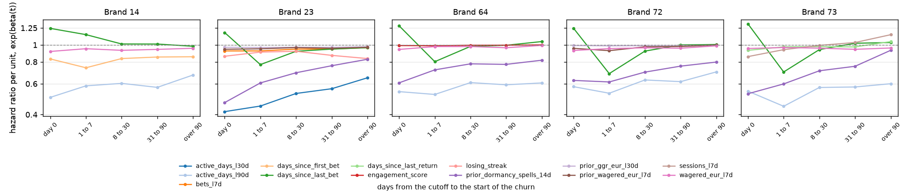

# Cox PH: Proportional Hazards Check (review item P1 7)

Cox PH assumes that each covariate multiplies the hazard of churn by the same factor at every time after the cutoff. I check it on the training rows of the registered Cox model of each brand. Generated by `src/models/ph_check.py` (`make ph-check`).

- **Test**: Schoenfeld residual test (lifelines `proportional_hazard_test`, rank of time). With tens of thousands of events almost any deviation is significant, so I read the size of the change, not the p-value.
- **beta(t)**: the effect of the covariate on the events of each time window, beta plus the mean scaled Schoenfeld residual of those events (Grambsch and Therneau, 1994). Day 0 means that the churn starts on the cutoff itself (the `event_60d` = 1 players).
- **Verdict**: *negligible* if |beta(t)| < 0.05 in every window; *sign changes* if beta(t) is above 0.05 in one window and below -0.05 in another; *changes size* if the largest |beta(t)| is more than 1.5 times the smallest; *stable* otherwise.

## Brand 14

Run `cox_ph_brand14_1792127579`: 59,779 training rows, 42,259 events (day 0: 20,038, 1 to 7: 2,542, 8 to 30: 4,014, 31 to 90: 8,557, over 90: 7,108).

| covariate | beta | beta(t) day 0 | beta(t) 1 to 7 | beta(t) 8 to 30 | beta(t) 31 to 90 | beta(t) over 90 | rho | chi2 | p | verdict |
|---|---|---|---|---|---|---|---|---|---|---|
| `active_days_l90d` | -0.557 | -0.690 | -0.539 | -0.506 | -0.559 | -0.396 | 0.101 | 172 | 2.3e-39 | changes size |
| `days_since_first_bet` | -0.189 | -0.184 | -0.301 | -0.179 | -0.159 | -0.156 | 0.045 | 55 | 1.0e-13 | changes size |
| `days_since_last_bet` | 0.119 | 0.218 | 0.135 | 0.012 | 0.011 | -0.018 | -0.091 | 213 | 2.5e-48 | changes size |
| `wagered_eur_l7d` | -0.069 | -0.086 | -0.050 | -0.071 | -0.059 | -0.044 | 0.010 | 51 | 1.1e-12 | stable |

## Brand 23

Run `cox_ph_brand23_1792128092`: 235,552 training rows, 153,655 events (day 0: 66,834, 1 to 7: 7,377, 8 to 30: 18,963, 31 to 90: 34,193, over 90: 26,288).

| covariate | beta | beta(t) day 0 | beta(t) 1 to 7 | beta(t) 8 to 30 | beta(t) 31 to 90 | beta(t) over 90 | rho | chi2 | p | verdict |
|---|---|---|---|---|---|---|---|---|---|---|
| `active_days_l30d` | -0.613 | -0.878 | -0.804 | -0.639 | -0.576 | -0.433 | 0.135 | 1690 | 0.0e+00 | changes size |
| `bets_l7d` | -0.059 | -0.079 | -0.079 | -0.055 | -0.054 | -0.036 | 0.038 | 198 | 5.0e-45 | stable |
| `days_since_last_bet` | 0.055 | 0.162 | -0.259 | -0.084 | -0.055 | -0.036 | -0.098 | 594 | 3.9e-131 | sign changes |
| `losing_streak` | -0.146 | -0.149 | -0.094 | -0.084 | -0.138 | -0.180 | 0.017 | 42 | 9.2e-11 | changes size |
| `prior_dormancy_spells_14d` | -0.445 | -0.759 | -0.500 | -0.366 | -0.274 | -0.189 | 0.127 | 4943 | 0.0e+00 | changes size |
| `prior_ggr_eur_l30d` | -0.030 | -0.032 | -0.034 | -0.030 | -0.032 | -0.024 | 0.072 | 33 | 1.0e-08 | negligible |
| `prior_wagered_eur_l7d` | -0.052 | -0.057 | -0.051 | -0.035 | -0.044 | -0.032 | 0.023 | 114 | 1.5e-26 | stable |

## Brand 64

Run `cox_ph_brand64_1792127362`: 111,805 training rows, 84,255 events (day 0: 39,679, 1 to 7: 3,972, 8 to 30: 10,464, 31 to 90: 18,327, over 90: 11,813).

| covariate | beta | beta(t) day 0 | beta(t) 1 to 7 | beta(t) 8 to 30 | beta(t) 31 to 90 | beta(t) over 90 | rho | chi2 | p | verdict |
|---|---|---|---|---|---|---|---|---|---|---|
| `active_days_l90d` | -0.484 | -0.615 | -0.652 | -0.496 | -0.525 | -0.500 | 0.085 | 199 | 3.7e-45 | stable |
| `days_since_last_bet` | 0.111 | 0.252 | -0.220 | -0.019 | -0.005 | 0.044 | -0.120 | 471 | 2.4e-104 | sign changes |
| `engagement_score` | -0.007 | -0.008 | -0.011 | -0.005 | -0.004 | 0.000 | -0.071 | 221 | 5.1e-50 | negligible |
| `prior_dormancy_spells_14d` | -0.341 | -0.499 | -0.328 | -0.249 | -0.256 | -0.201 | 0.072 | 1179 | 2.6e-258 | changes size |
| `wagered_eur_l7d` | -0.040 | -0.059 | -0.022 | -0.022 | -0.037 | -0.006 | 0.013 | 112 | 2.9e-26 | stable |

## Brand 72

Run `cox_ph_brand72_1792128882`: 108,937 training rows, 94,156 events (day 0: 59,949, 1 to 7: 4,725, 8 to 30: 9,272, 31 to 90: 13,183, over 90: 7,027).

| covariate | beta | beta(t) day 0 | beta(t) 1 to 7 | beta(t) 8 to 30 | beta(t) 31 to 90 | beta(t) over 90 | rho | chi2 | p | verdict |
|---|---|---|---|---|---|---|---|---|---|---|
| `active_days_l90d` | -0.478 | -0.549 | -0.636 | -0.461 | -0.483 | -0.355 | 0.018 | 42 | 1.1e-10 | changes size |
| `days_since_last_bet` | 0.116 | 0.219 | -0.378 | -0.081 | -0.000 | 0.005 | -0.099 | 376 | 7.8e-84 | sign changes |
| `prior_dormancy_spells_14d` | -0.403 | -0.467 | -0.487 | -0.358 | -0.279 | -0.226 | -0.001 | 519 | 8.6e-115 | changes size |
| `prior_ggr_eur_l30d` | -0.012 | -0.008 | -0.013 | -0.010 | -0.010 | -0.005 | 0.029 | 5 | 2.4e-02 | negligible |
| `prior_wagered_eur_l7d` | -0.041 | -0.045 | -0.076 | -0.025 | -0.021 | -0.001 | -0.017 | 144 | 3.1e-33 | stable |
| `wagered_eur_l7d` | -0.058 | -0.073 | -0.049 | -0.038 | -0.044 | -0.012 | -0.007 | 170 | 8.6e-39 | stable |

## Brand 73

Run `cox_ph_brand73_1792129457`: 241,670 training rows, 190,545 events (day 0: 103,775, 1 to 7: 9,898, 8 to 30: 20,727, 31 to 90: 33,381, over 90: 22,764).

| covariate | beta | beta(t) day 0 | beta(t) 1 to 7 | beta(t) 8 to 30 | beta(t) 31 to 90 | beta(t) over 90 | rho | chi2 | p | verdict |
|---|---|---|---|---|---|---|---|---|---|---|
| `active_days_l90d` | -0.571 | -0.608 | -0.807 | -0.560 | -0.553 | -0.511 | 0.049 | 136 | 1.6e-31 | changes size |
| `days_since_last_bet` | 0.127 | 0.277 | -0.356 | -0.062 | 0.022 | 0.031 | -0.102 | 1068 | 3.5e-234 | sign changes |
| `days_since_last_return` | -0.034 | -0.072 | -0.026 | -0.023 | -0.027 | 0.044 | 0.039 | 108 | 2.6e-25 | stable |
| `prior_dormancy_spells_14d` | -0.451 | -0.642 | -0.513 | -0.340 | -0.281 | -0.071 | 0.042 | 1237 | 7.1e-271 | changes size |
| `sessions_l7d` | -0.084 | -0.154 | -0.062 | -0.006 | 0.032 | 0.134 | -0.032 | 192 | 9.1e-44 | sign changes |
| `wagered_eur_l7d` | -0.045 | -0.047 | -0.034 | -0.043 | -0.058 | -0.041 | -0.049 | 14 | 1.8e-04 | stable |

