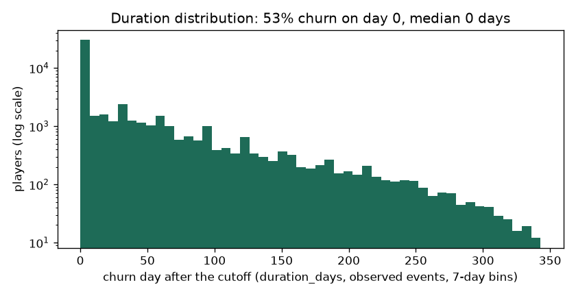
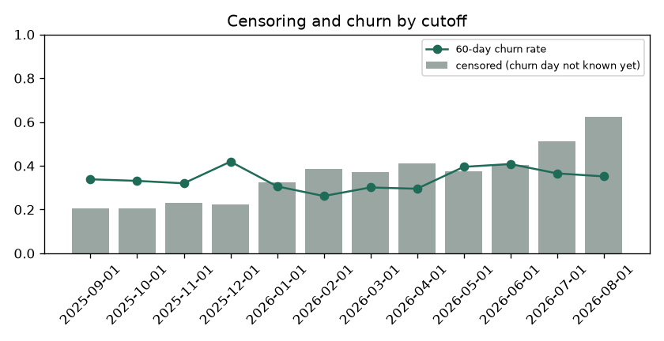

# EDA Summary vs Benchmark: Training Snapshot (brandId 14)

EDA stage 4 of the delivery plan: every statistic of the training snapshot next to its benchmark.

| | |
|---|---|
| Snapshot | `data/processed/train_dataset_14_2025-09-01_2025-10-01_2025-11-01_2025-12-01_2026-01-01_2026-02-01_2026-03-01_2026-04-01_2026-05-01_2026-06-01_2026-07-01_2026-08-01_1792127495.parquet` |
| Benchmark | `data/processed/train_dataset_14_2025-09-01_2025-10-01_2025-11-01_2025-12-01_2026-01-01_2026-02-01_2026-03-01_2026-04-01_2026-05-01_2026-06-01_2026-07-01_2026-08-01_1791433689.parquet` (the previous dataset of the brand) |
| Status | 16 critical, 22 warn, 46 ok |

Thresholds: row counts and null shares as in `configs/eda_alerts.yaml` (row count +-20% warn, +-50% critical; null share +5 / +20 points; PSI 0.10 / 0.25); a label rate that moves more than 5 points is a warning. Medians are in real units (days, EUR, counts).

## 1. Snapshot, Labels and Durations

| metric | current | benchmark | delta | status |
|---|---|---|---|---|
| rows | 80,106 | 147,850 | -67,744 | warn |
| players | 28,138 | 79,006 | -50,868 | critical |
| cutoffs | 12 | 12 | 0 | info |
| rows_per_cutoff | 6,676 | 12,321 | -5,645 | warn |
| churn_rate_60d | 0.346 | 0.570 | -0.224 | warn |
| churn_within_7d_rate | 0.386 |  |  | new |
| churn_within_14d_rate | 0.407 |  |  | new |
| churn_within_30d_rate | 0.454 |  |  | new |
| event_rate | 0.652 | 0.803 | -0.151 | warn |
| censoring_rate | 0.348 | 0.197 | 0.151 | warn |
| duration_day0_share | 0.530 | 0.710 | -0.180 | info |
| duration_p50_days | 0 | 0 | 0 | info |
| duration_p75_days | 45 | 9 | 36 | info |
| duration_p90_days | 113 | 62 | 51 | info |
| duration_max_days | 340 | 340 | 0 | info |

## 2. Censoring and Duration Distribution

`duration_days` is the day the churn starts after the cutoff (0 = no bet in the next 60 days); a player is censored when the 60-day silence that would confirm it does not fit in the data yet. Censoring grows for recent cutoffs, which have less data after them.

| cutoff_date | rows | churn_rate_60d | churn_within_7d_rate | churn_within_14d_rate | churn_within_30d_rate | censoring_rate | median_churn_day |
|---|---|---|---|---|---|---|---|
| 2025-09-01 | 7331 | 0.338 | 0.374 | 0.393 | 0.440 | 0.204 | 16 |
| 2025-10-01 | 7756 | 0.331 | 0.368 | 0.382 | 0.423 | 0.206 | 20.500 |
| 2025-11-01 | 7195 | 0.320 | 0.377 | 0.407 | 0.488 | 0.231 | 9 |
| 2025-12-01 | 8174 | 0.419 | 0.465 | 0.479 | 0.524 | 0.225 | 0 |
| 2026-01-01 | 5812 | 0.306 | 0.348 | 0.367 | 0.401 | 0.325 | 5 |
| 2026-02-01 | 5159 | 0.262 | 0.304 | 0.319 | 0.366 | 0.386 | 9 |
| 2026-03-01 | 5885 | 0.301 | 0.341 | 0.357 | 0.389 | 0.371 | 2 |
| 2026-04-01 | 5624 | 0.295 | 0.335 | 0.358 | 0.416 | 0.410 | 0.500 |
| 2026-05-01 | 6843 | 0.395 | 0.437 | 0.459 | 0.503 | 0.374 | 0 |
| 2026-06-01 | 7158 | 0.408 | 0.447 | 0.473 | 0.516 | 0.405 | 0 |
| 2026-07-01 | 6662 | 0.365 | 0.398 | 0.420 | 0.471 | 0.512 | 0 |
| 2026-08-01 | 6507 | 0.352 | <NA> | <NA> | <NA> | 0.624 | 0 |

## 3. Features

Flagged against the benchmark:

| metric | current | benchmark | delta | status |
|---|---|---|---|---|
| null_share__heavy_loss_multiple | 0.153 | 0.094 | 0.060 | warn |
| psi__days_since_last_deposit | 0.390 | 0 | 0.390 | critical |
| psi__active_days_l7d | 6.668 | 0 | 6.668 | critical |
| psi__active_days_l30d | 0.108 | 0 | 0.108 | warn |
| psi__active_days_l90d | 0.221 | 0 | 0.221 | warn |
| psi__bets_l7d | 0.103 | 0 | 0.103 | warn |
| psi__bets_l30d | 0.237 | 0 | 0.237 | warn |
| psi__sessions_l7d | 0.145 | 0 | 0.145 | warn |
| psi__sessions_l30d | 0.403 | 0 | 0.403 | critical |
| psi__n_deposit_days_7d | 0.166 | 0 | 0.166 | warn |
| psi__n_deposit_days_30d | 0.766 | 0 | 0.766 | critical |
| psi__wagered_eur_l7d | 0.131 | 0 | 0.131 | warn |
| psi__wagered_eur_l30d | 0.365 | 0 | 0.365 | critical |
| psi__wagered_eur_l90d | 0.470 | 0 | 0.470 | critical |
| psi__net_loss_7d | 0.155 | 0 | 0.155 | warn |
| psi__ggr_eur_l30d | 0.522 | 0 | 0.522 | critical |
| psi__deposits_eur_l30d | 0.404 | 0 | 0.404 | critical |
| psi__prior_wagered_eur_l7d | 0.124 | 0 | 0.124 | warn |
| psi__prior_active_days_l7d | 6.337 | 0 | 6.337 | critical |
| psi__prior_ggr_eur_l30d | 0.235 | 0 | 0.235 | warn |
| psi__wagered_trend_7 | 0.126 | 0 | 0.126 | warn |
| psi__heavy_loss_multiple | 0.143 | 0 | 0.143 | warn |
| psi__days_since_first_bet | 0.193 | 0 | 0.193 | warn |
| psi__engagement_score | 0.430 | 0 | 0.430 | critical |
| psi__games_breadth_30d | 0.269 | 0 | 0.269 | critical |
| psi__games_breadth_ratio | 0.292 | 0 | 0.292 | critical |
| psi__bonus_stake_share_30d | 0.484 | 0 | 0.484 | critical |
| psi__losing_streak | 0.319 | 0 | 0.319 | critical |
| psi__deposited_within_7d | 0.166 | 0 | 0.166 | warn |
| psi__deposited_within_14d | 0.292 | 0 | 0.292 | critical |
| psi__deposit_frequency_score | 0.122 | 0 | 0.122 | warn |
| psi__failed_deposits_14d | 0.123 | 0 | 0.123 | warn |

| feature | null share | null share, benchmark | median | PSI |
|---|---|---|---|---|
| days_since_last_bet | 0 | 0 | 5 | 0.095 |
| days_since_last_deposit | 0.591 | 0.606 | 9 | 0.390 |
| active_days_l7d | 0 | 0 | 1 | 6.668 |
| active_days_l30d | 0 | 0 | 3 | 0.108 |
| active_days_l90d | 0 | 0 | 8 | 0.221 |
| bets_l7d | 0 | 0 | 34 | 0.103 |
| bets_l30d | 0 | 0 | 1,077 | 0.237 |
| sessions_l7d | 0 | 0 | 1 | 0.145 |
| sessions_l30d | 0 | 0 | 5 | 0.403 |
| n_deposit_days_7d | 0.591 | 0.606 | 0 | 0.166 |
| n_deposit_days_30d | 0.591 | 0.606 | 2 | 0.766 |
| wagered_eur_l7d | 0 | 0 | 18.106 | 0.131 |
| wagered_eur_l30d | 0 | 0 | 700 | 0.365 |
| wagered_eur_l90d | 0 | 0 | 2,061 | 0.470 |
| net_loss_7d | 0 | 0 | 0 | 0.155 |
| ggr_eur_l30d | 0 | 0 | 46.932 | 0.522 |
| deposits_eur_l30d | 0.591 | 0.606 | 92.217 | 0.404 |
| withdrawals_30d_share | 0.640 | 0.805 | 0 | 0.000 |
| prior_wagered_eur_l7d | 0 | 0 | 5.582 | 0.124 |
| prior_active_days_l7d | 0 | 0 | 1 | 6.337 |
| prior_ggr_eur_l30d | 0 | 0 | 4.965 | 0.235 |
| wagered_trend_7 | 0 | 0 | 1 | 0.126 |
| heavy_loss_multiple | 0.153 | 0.094 | 0.018 | 0.143 |
| deposits_30_vs_prior30 | 0.819 | 0.900 | 0.903 | 0.003 |
| days_since_first_bet | 0 | 0 | 150 | 0.193 |
| prior_dormancy_spells_14d | 0 | 0 | 1 | 0.082 |
| days_since_last_return | 0 | 0 | 64 | 0.037 |
| engagement_score | 0 | 0 | 8.298 | 0.430 |
| games_breadth_30d | 0 | 0 | 4 | 0.269 |
| games_breadth_ratio | 0 | 0 | 1.500 | 0.292 |
| bonus_stake_share_30d | 0 | 0.002 | 0.102 | 0.484 |
| losing_streak | 0 | 0 | 2 | 0.319 |
| avg_bet_eur_l30d | 0 | 0 | 0.530 | 0.046 |
| night_play_index | 0 | 0 | 0 | 0 |
| deposited_within_3d | 0.591 | 0.606 | 0 | 0.094 |
| deposited_within_7d | 0.591 | 0.606 | 0 | 0.166 |
| deposited_within_14d | 0.591 | 0.606 | 1 | 0.292 |
| deposit_frequency_score | 0.591 | 0.606 | 0 | 0.122 |
| failed_deposits_14d | 0.591 | 0.606 | 0 | 0.123 |

Generated by `eda/summary.py` (`make eda-summary`; the pipeline runs it after building the dataset). Table: `data/03_output/eda_summary/brand14/summary.csv`.
