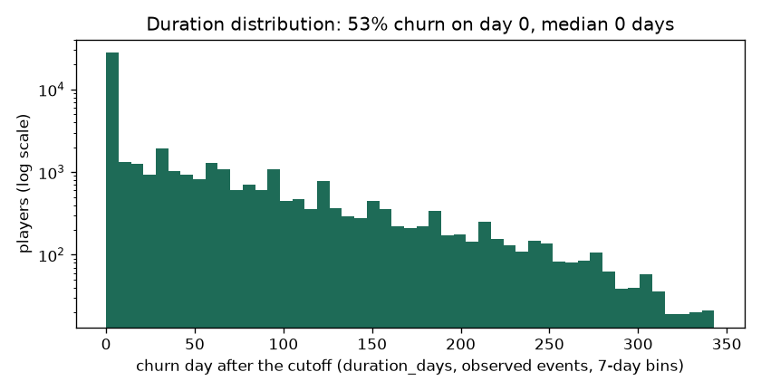
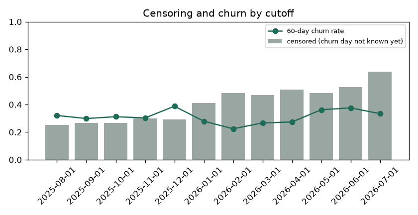

# EDA Summary vs Benchmark: Training Snapshot (brandId 14)

EDA stage 4 of the delivery plan: every statistic of the training snapshot next to its benchmark.

| | |
|---|---|
| Snapshot | `data/processed/churn90d/train_dataset_14_2025-08-01_2025-09-01_2025-10-01_2025-11-01_2025-12-01_2026-01-01_2026-02-01_2026-03-01_2026-04-01_2026-05-01_2026-06-01_2026-07-01_1792151724.parquet` |
| Benchmark | `none (first dataset)` (the previous dataset of the brand) |
| Status | 0 critical, 0 warn, 0 ok |

Thresholds: row counts and null shares as in `configs/eda_alerts.yaml` (row count +-20% warn, +-50% critical; null share +5 / +20 points; PSI 0.10 / 0.25); a label rate that moves more than 5 points is a warning. Medians are in real units (days, EUR, counts).

## 1. Snapshot, Labels and Durations

| metric | current | benchmark | delta | status |
|---|---|---|---|---|
| rows | 80,754 |  |  | new |
| players | 28,394 |  |  | new |
| cutoffs | 12 |  |  | new |
| rows_per_cutoff | 6,730 |  |  | new |
| churn_rate_60d | 0.316 |  |  | new |
| churn_within_7d_rate | 0.350 |  |  | new |
| churn_within_14d_rate | 0.366 |  |  | new |
| churn_within_30d_rate | 0.403 |  |  | new |
| event_rate | 0.601 |  |  | new |
| censoring_rate | 0.399 |  |  | new |
| duration_day0_share | 0.526 |  |  | new |
| duration_p50_days | 0 |  |  | new |
| duration_p75_days | 57 |  |  | new |
| duration_p90_days | 125 |  |  | new |
| duration_max_days | 341 |  |  | new |

## 2. Censoring and Duration Distribution

`duration_days` is the day the churn starts after the cutoff (0 = no bet in the next 60 days); a player is censored when the 60-day silence that would confirm it does not fit in the data yet. Censoring grows for recent cutoffs, which have less data after them.

| cutoff_date | rows | churn_rate_60d | churn_within_7d_rate | churn_within_14d_rate | churn_within_30d_rate | censoring_rate | median_churn_day |
|---|---|---|---|---|---|---|---|
| 2025-08-01 | 7155 | 0.321 | 0.348 | 0.368 | 0.397 | 0.252 | 19 |
| 2025-09-01 | 7331 | 0.299 | 0.327 | 0.344 | 0.383 | 0.268 | 25 |
| 2025-10-01 | 7756 | 0.312 | 0.344 | 0.356 | 0.391 | 0.268 | 19 |
| 2025-11-01 | 7195 | 0.303 | 0.353 | 0.378 | 0.444 | 0.300 | 7 |
| 2025-12-01 | 8174 | 0.388 | 0.426 | 0.437 | 0.476 | 0.293 | 0 |
| 2026-01-01 | 5812 | 0.279 | 0.314 | 0.330 | 0.356 | 0.410 | 2 |
| 2026-02-01 | 5159 | 0.224 | 0.258 | 0.269 | 0.305 | 0.485 | 8 |
| 2026-03-01 | 5885 | 0.267 | 0.300 | 0.313 | 0.338 | 0.469 | 0 |
| 2026-04-01 | 5624 | 0.273 | 0.306 | 0.327 | 0.374 | 0.510 | 0 |
| 2026-05-01 | 6843 | 0.362 | 0.396 | 0.414 | 0.447 | 0.484 | 0 |
| 2026-06-01 | 7158 | 0.376 | 0.408 | 0.430 | 0.463 | 0.525 | 0 |
| 2026-07-01 | 6662 | 0.334 | 0.361 | <NA> | <NA> | 0.639 | 0 |

## 3. Features

No feature flagged against the benchmark.

| feature | null share | null share, benchmark | median | PSI |
|---|---|---|---|---|
| days_since_last_bet | 0 |  | 5 |  |
| days_since_last_deposit | 0.674 |  | 9 |  |
| active_days_l7d | 0 |  | 1 |  |
| active_days_l30d | 0 |  | 3 |  |
| active_days_l90d | 0 |  | 7 |  |
| bets_l7d | 0 |  | 30 |  |
| bets_l30d | 0 |  | 1,032 |  |
| sessions_l7d | 0 |  | 1 |  |
| sessions_l30d | 0 |  | 4 |  |
| n_deposit_days_7d | 0.674 |  | 0 |  |
| n_deposit_days_30d | 0.674 |  | 2 |  |
| wagered_eur_l7d | 0 |  | 15.927 |  |
| wagered_eur_l30d | 0 |  | 661 |  |
| wagered_eur_l90d | 0 |  | 1,917 |  |
| net_loss_7d | 0 |  | 0 |  |
| ggr_eur_l30d | 0 |  | 43.650 |  |
| deposits_eur_l30d | 0.674 |  | 93.498 |  |
| withdrawals_30d_share | 0.714 |  | 0 |  |
| prior_wagered_eur_l7d | 0 |  | 5.309 |  |
| prior_active_days_l7d | 0 |  | 1 |  |
| prior_ggr_eur_l30d | 0 |  | 3.254 |  |
| wagered_trend_7 | 0 |  | 1 |  |
| heavy_loss_multiple | 0.159 |  | 0.006 |  |
| deposits_30_vs_prior30 | 0.867 |  | 1.003 |  |
| days_since_first_bet | 0 |  | 150 |  |
| prior_dormancy_spells_14d | 0 |  | 1 |  |
| days_since_last_return | 0 |  | 69 |  |
| engagement_score | 0 |  | 8.085 |  |
| games_breadth_30d | 0 |  | 4 |  |
| games_breadth_ratio | 0 |  | 1.526 |  |
| bonus_stake_share_30d | 0 |  | 0.101 |  |
| losing_streak | 0 |  | 2 |  |
| avg_bet_eur_l30d | 0 |  | 0.523 |  |
| night_play_index | 0 |  | 0 |  |
| deposited_within_3d | 0.674 |  | 0 |  |
| deposited_within_7d | 0.674 |  | 0 |  |
| deposited_within_14d | 0.674 |  | 1 |  |
| deposit_frequency_score | 0.674 |  | 0 |  |
| failed_deposits_14d | 0.674 |  | 0 |  |

Generated by `eda/summary.py` (`make eda-summary`; the pipeline runs it after building the dataset). Table: `data/03_output/eda_summary/brand14_churn90d/summary.csv`.
