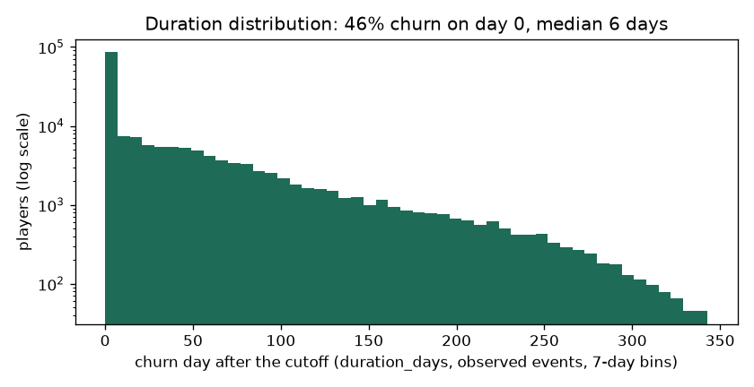
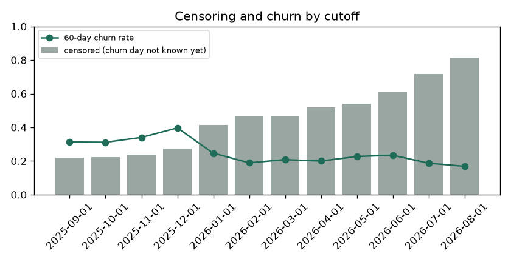

# EDA Summary vs Benchmark: Training Snapshot (brandId 23)

EDA stage 4 of the delivery plan: every statistic of the training snapshot next to its benchmark.

| | |
|---|---|
| Snapshot | `data/processed/train_dataset_23_2025-09-01_2025-10-01_2025-11-01_2025-12-01_2026-01-01_2026-02-01_2026-03-01_2026-04-01_2026-05-01_2026-06-01_2026-07-01_2026-08-01_1792127749.parquet` |
| Benchmark | `data/processed/train_dataset_23_2025-09-01_2025-10-01_2025-11-01_2025-12-01_2026-01-01_2026-02-01_2026-03-01_2026-04-01_2026-05-01_2026-06-01_2026-07-01_2026-08-01_1791545116.parquet` (the previous dataset of the brand) |
| Status | 3 critical, 13 warn, 71 ok |

Thresholds: row counts and null shares as in `configs/eda_alerts.yaml` (row count +-20% warn, +-50% critical; null share +5 / +20 points; PSI 0.10 / 0.25); a label rate that moves more than 5 points is a warning. Medians are in real units (days, EUR, counts).

## 1. Snapshot, Labels and Durations

| metric | current | benchmark | delta | status |
|---|---|---|---|---|
| rows | 296,202 | 395,163 | -98,961 | warn |
| players | 83,506 | 129,202 | -45,696 | warn |
| cutoffs | 12 | 12 | 0 | info |
| rows_per_cutoff | 24,684 | 32,930 | -8,247 | warn |
| churn_rate_60d | 0.266 | 0.310 | -0.044 | ok |
| churn_within_7d_rate | 0.303 | 0.346 | -0.043 | ok |
| churn_within_14d_rate | 0.329 | 0.370 | -0.040 | ok |
| churn_within_30d_rate | 0.381 | 0.414 | -0.033 | ok |
| event_rate | 0.578 | 0.595 | -0.017 | ok |
| censoring_rate | 0.422 | 0.405 | 0.017 | ok |
| duration_day0_share | 0.460 | 0.521 | -0.061 | info |
| duration_p50_days | 6 | 0 | 6 | info |
| duration_p75_days | 57 | 49 | 8 | info |
| duration_p90_days | 123 | 114 | 9 | info |
| duration_max_days | 340 | 340 | 0 | info |

## 2. Censoring and Duration Distribution

`duration_days` is the day the churn starts after the cutoff (0 = no bet in the next 60 days); a player is censored when the 60-day silence that would confirm it does not fit in the data yet. Censoring grows for recent cutoffs, which have less data after them.

| cutoff_date | rows | churn_rate_60d | churn_within_7d_rate | churn_within_14d_rate | churn_within_30d_rate | censoring_rate | median_churn_day |
|---|---|---|---|---|---|---|---|
| 2025-09-01 | 32181 | 0.313 | 0.342 | 0.363 | 0.407 | 0.221 | 24 |
| 2025-10-01 | 33646 | 0.312 | 0.344 | 0.373 | 0.428 | 0.224 | 18 |
| 2025-11-01 | 33608 | 0.340 | 0.380 | 0.422 | 0.519 | 0.238 | 8 |
| 2025-12-01 | 31038 | 0.397 | 0.431 | 0.461 | 0.505 | 0.275 | 0 |
| 2026-01-01 | 20054 | 0.247 | 0.274 | 0.290 | 0.325 | 0.413 | 16 |
| 2026-02-01 | 19720 | 0.189 | 0.215 | 0.234 | 0.275 | 0.464 | 28 |
| 2026-03-01 | 22149 | 0.208 | 0.235 | 0.259 | 0.312 | 0.465 | 17 |
| 2026-04-01 | 21103 | 0.200 | 0.225 | 0.249 | 0.298 | 0.521 | 11 |
| 2026-05-01 | 22053 | 0.227 | 0.264 | 0.290 | 0.335 | 0.542 | 1 |
| 2026-06-01 | 21421 | 0.235 | 0.259 | 0.281 | 0.322 | 0.608 | 0 |
| 2026-07-01 | 19785 | 0.187 | 0.208 | 0.232 | 0.270 | 0.718 | 0 |
| 2026-08-01 | 19444 | 0.168 | <NA> | <NA> | <NA> | 0.815 | 0 |

## 3. Features

Flagged against the benchmark:

| metric | current | benchmark | delta | status |
|---|---|---|---|---|
| psi__days_since_last_deposit | 0.139 | 0 | 0.139 | warn |
| psi__active_days_l7d | 7.556 | 0 | 7.556 | critical |
| psi__bets_l30d | 0.112 | 0 | 0.112 | warn |
| psi__sessions_l30d | 0.110 | 0 | 0.110 | warn |
| psi__n_deposit_days_30d | 0.206 | 0 | 0.206 | warn |
| psi__wagered_eur_l30d | 0.176 | 0 | 0.176 | warn |
| psi__wagered_eur_l90d | 0.146 | 0 | 0.146 | warn |
| psi__ggr_eur_l30d | 0.130 | 0 | 0.130 | warn |
| psi__deposits_eur_l30d | 0.146 | 0 | 0.146 | warn |
| psi__prior_active_days_l7d | 7.814 | 0 | 7.814 | critical |
| psi__engagement_score | 0.128 | 0 | 0.128 | warn |
| psi__games_breadth_30d | 0.127 | 0 | 0.127 | warn |
| psi__bonus_stake_share_30d | 0.351 | 0 | 0.351 | critical |

| feature | null share | null share, benchmark | median | PSI |
|---|---|---|---|---|
| days_since_last_bet | 0 | 0 | 5 | 0.006 |
| days_since_last_deposit | 0.650 | 0.679 | 7 | 0.139 |
| active_days_l7d | 0 | 0 | 1 | 7.556 |
| active_days_l30d | 0 | 0 | 4 | 0.051 |
| active_days_l90d | 0 | 0 | 12 | 0.015 |
| bets_l7d | 0 | 0 | 66 | 0.035 |
| bets_l30d | 0 | 0 | 1,229 | 0.112 |
| sessions_l7d | 0 | 0 | 1 | 0.039 |
| sessions_l30d | 0 | 0 | 7 | 0.110 |
| n_deposit_days_7d | 0.650 | 0.679 | 0 | 0.033 |
| n_deposit_days_30d | 0.650 | 0.679 | 3 | 0.206 |
| wagered_eur_l7d | 0 | 0 | 20.858 | 0.043 |
| wagered_eur_l30d | 0 | 0 | 654 | 0.176 |
| wagered_eur_l90d | 0 | 0 | 2,105 | 0.146 |
| net_loss_7d | 0 | 0 | 0.458 | 0.041 |
| ggr_eur_l30d | 0 | 0 | 46.450 | 0.130 |
| deposits_eur_l30d | 0.650 | 0.679 | 169 | 0.146 |
| withdrawals_30d_share | 0.681 | 0.761 | 0 | 0.000 |
| prior_wagered_eur_l7d | 0 | 0 | 31.676 | 0.052 |
| prior_active_days_l7d | 0 | 0 | 1 | 7.814 |
| prior_ggr_eur_l30d | 0 | 0 | 15.673 | 0.049 |
| wagered_trend_7 | 0 | 0 | 1 | 0.026 |
| heavy_loss_multiple | 0.187 | 0.168 | 0.098 | 0.024 |
| deposits_30_vs_prior30 | 0.803 | 0.842 | 0.874 | 0.021 |
| days_since_first_bet | 0 | 0 | 150 | 0.012 |
| prior_dormancy_spells_14d | 0 | 0 | 1 | 0.009 |
| days_since_last_return | 0 | 0 | 52 | 0.011 |
| engagement_score | 0 | 0 | 13.249 | 0.128 |
| games_breadth_30d | 0 | 0 | 5 | 0.127 |
| games_breadth_ratio | 0 | 0 | 1.286 | 0.046 |
| bonus_stake_share_30d | 0 | 0.015 | 0.104 | 0.351 |
| losing_streak | 0 | 0 | 3 | 0.022 |
| avg_bet_eur_l30d | 0 | 0 | 0.454 | 0.043 |
| night_play_index | 0 | 0 | 0 | 0 |
| deposited_within_3d | 0.650 | 0.679 | 0 | 0.018 |
| deposited_within_7d | 0.650 | 0.679 | 0 | 0.033 |
| deposited_within_14d | 0.650 | 0.679 | 1 | 0.063 |
| deposit_frequency_score | 0.650 | 0.679 | 0 | 0.032 |
| failed_deposits_14d | 0.650 | 0.679 | 0 | 0.025 |

Generated by `eda/summary.py` (`make eda-summary`; the pipeline runs it after building the dataset). Table: `data/03_output/eda_summary/brand23/summary.csv`.
