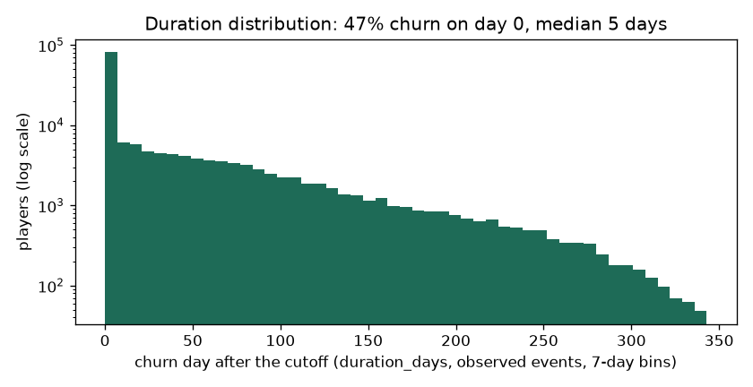
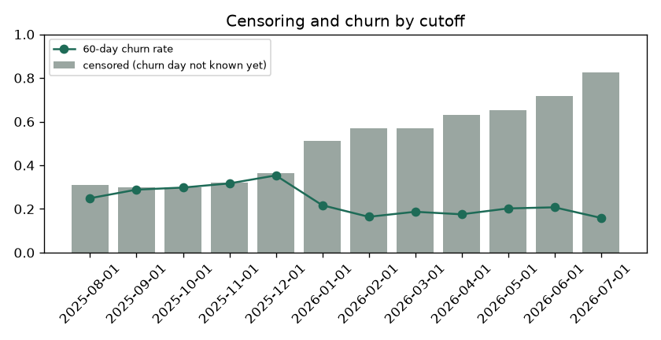

# EDA Summary vs Benchmark: Training Snapshot (brandId 23)

EDA stage 4 of the delivery plan: every statistic of the training snapshot next to its benchmark.

| | |
|---|---|
| Snapshot | `data/processed/churn90d/train_dataset_23_2025-08-01_2025-09-01_2025-10-01_2025-11-01_2025-12-01_2026-01-01_2026-02-01_2026-03-01_2026-04-01_2026-05-01_2026-06-01_2026-07-01_1792152022.parquet` |
| Benchmark | `none (first dataset)` (the previous dataset of the brand) |
| Status | 0 critical, 0 warn, 0 ok |

Thresholds: row counts and null shares as in `configs/eda_alerts.yaml` (row count +-20% warn, +-50% critical; null share +5 / +20 points; PSI 0.10 / 0.25); a label rate that moves more than 5 points is a warning. Medians are in real units (days, EUR, counts).

## 1. Snapshot, Labels and Durations

| metric | current | benchmark | delta | status |
|---|---|---|---|---|
| rows | 305,464 |  |  | new |
| players | 87,926 |  |  | new |
| cutoffs | 12 |  |  | new |
| rows_per_cutoff | 25,455 |  |  | new |
| churn_rate_60d | 0.247 |  |  | new |
| churn_within_7d_rate | 0.272 |  |  | new |
| churn_within_14d_rate | 0.299 |  |  | new |
| churn_within_30d_rate | 0.339 |  |  | new |
| event_rate | 0.528 |  |  | new |
| censoring_rate | 0.472 |  |  | new |
| duration_day0_share | 0.468 |  |  | new |
| duration_p50_days | 5 |  |  | new |
| duration_p75_days | 66 |  |  | new |
| duration_p90_days | 137 |  |  | new |
| duration_max_days | 341 |  |  | new |

## 2. Censoring and Duration Distribution

`duration_days` is the day the churn starts after the cutoff (0 = no bet in the next 60 days); a player is censored when the 60-day silence that would confirm it does not fit in the data yet. Censoring grows for recent cutoffs, which have less data after them.

| cutoff_date | rows | churn_rate_60d | churn_within_7d_rate | churn_within_14d_rate | churn_within_30d_rate | censoring_rate | median_churn_day |
|---|---|---|---|---|---|---|---|
| 2025-08-01 | 28706 | 0.249 | 0.273 | 0.289 | 0.322 | 0.310 | 42 |
| 2025-09-01 | 32181 | 0.288 | 0.312 | 0.329 | 0.367 | 0.298 | 24 |
| 2025-10-01 | 33646 | 0.298 | 0.327 | 0.353 | 0.399 | 0.300 | 14 |
| 2025-11-01 | 33608 | 0.317 | 0.350 | 0.383 | 0.456 | 0.321 | 5 |
| 2025-12-01 | 31038 | 0.354 | 0.380 | 0.404 | 0.438 | 0.363 | 0 |
| 2026-01-01 | 20054 | 0.217 | 0.238 | 0.250 | 0.277 | 0.512 | 11 |
| 2026-02-01 | 19720 | 0.164 | 0.183 | 0.198 | 0.229 | 0.569 | 23 |
| 2026-03-01 | 22149 | 0.187 | 0.208 | 0.228 | 0.269 | 0.569 | 10 |
| 2026-04-01 | 21103 | 0.176 | 0.195 | 0.214 | 0.252 | 0.631 | 3 |
| 2026-05-01 | 22053 | 0.202 | 0.232 | 0.253 | 0.288 | 0.652 | 0 |
| 2026-06-01 | 21421 | 0.208 | 0.226 | 0.243 | 0.272 | 0.719 | 0 |
| 2026-07-01 | 19785 | 0.159 | 0.175 | <NA> | <NA> | 0.825 | 0 |

## 3. Features

No feature flagged against the benchmark.

| feature | null share | null share, benchmark | median | PSI |
|---|---|---|---|---|
| days_since_last_bet | 0 |  | 5 |  |
| days_since_last_deposit | 0.724 |  | 7 |  |
| active_days_l7d | 0 |  | 1 |  |
| active_days_l30d | 0 |  | 4 |  |
| active_days_l90d | 0 |  | 12 |  |
| bets_l7d | 0 |  | 56 |  |
| bets_l30d | 0 |  | 1,112 |  |
| sessions_l7d | 0 |  | 1 |  |
| sessions_l30d | 0 |  | 7 |  |
| n_deposit_days_7d | 0.724 |  | 0 |  |
| n_deposit_days_30d | 0.724 |  | 3 |  |
| wagered_eur_l7d | 0 |  | 17.217 |  |
| wagered_eur_l30d | 0 |  | 576 |  |
| wagered_eur_l90d | 0 |  | 1,830 |  |
| net_loss_7d | 0 |  | 0.014 |  |
| ggr_eur_l30d | 0 |  | 41.240 |  |
| deposits_eur_l30d | 0.724 |  | 162 |  |
| withdrawals_30d_share | 0.750 |  | 0 |  |
| prior_wagered_eur_l7d | 0 |  | 26.584 |  |
| prior_active_days_l7d | 0 |  | 1 |  |
| prior_ggr_eur_l30d | 0 |  | 11.540 |  |
| wagered_trend_7 | 0 |  | 1 |  |
| heavy_loss_multiple | 0.194 |  | 0.074 |  |
| deposits_30_vs_prior30 | 0.856 |  | 0.995 |  |
| days_since_first_bet | 0 |  | 150 |  |
| prior_dormancy_spells_14d | 0 |  | 1 |  |
| days_since_last_return | 0 |  | 54 |  |
| engagement_score | 0 |  | 12.601 |  |
| games_breadth_30d | 0 |  | 5 |  |
| games_breadth_ratio | 0 |  | 1.333 |  |
| bonus_stake_share_30d | 0 |  | 0.103 |  |
| losing_streak | 0 |  | 3 |  |
| avg_bet_eur_l30d | 0 |  | 0.441 |  |
| night_play_index | 0 |  | 0 |  |
| deposited_within_3d | 0.724 |  | 0 |  |
| deposited_within_7d | 0.724 |  | 0 |  |
| deposited_within_14d | 0.724 |  | 1 |  |
| deposit_frequency_score | 0.724 |  | 0 |  |
| failed_deposits_14d | 0.724 |  | 0 |  |

Generated by `eda/summary.py` (`make eda-summary`; the pipeline runs it after building the dataset). Table: `data/03_output/eda_summary/brand23_churn90d/summary.csv`.
