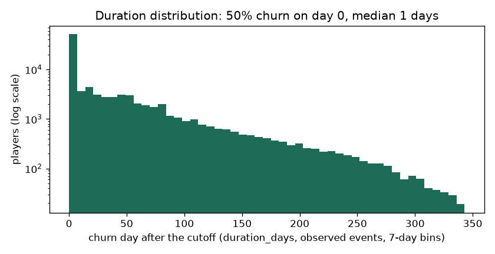
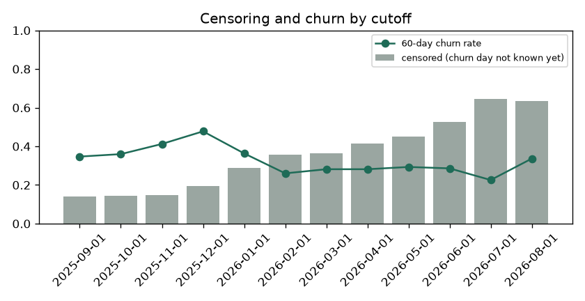

# EDA Summary vs Benchmark: Training Snapshot (brandId 64)

EDA stage 4 of the delivery plan: every statistic of the training snapshot next to its benchmark.

| | |
|---|---|
| Snapshot | `data/processed/train_dataset_64_2025-09-01_2025-10-01_2025-11-01_2025-12-01_2026-01-01_2026-02-01_2026-03-01_2026-04-01_2026-05-01_2026-06-01_2026-07-01_2026-08-01_1792127230.parquet` |
| Benchmark | `data/processed/train_dataset_64_2025-09-01_2025-10-01_2025-11-01_2025-12-01_2026-01-01_2026-02-01_2026-03-01_2026-04-01_2026-05-01_2026-06-01_2026-07-01_2026-08-01_1791444771.parquet` (the previous dataset of the brand) |
| Status | 4 critical, 14 warn, 69 ok |

Thresholds: row counts and null shares as in `configs/eda_alerts.yaml` (row count +-20% warn, +-50% critical; null share +5 / +20 points; PSI 0.10 / 0.25); a label rate that moves more than 5 points is a warning. Medians are in real units (days, EUR, counts).

## 1. Snapshot, Labels and Durations

| metric | current | benchmark | delta | status |
|---|---|---|---|---|
| rows | 139,124 | 180,122 | -40,998 | warn |
| players | 46,602 | 71,565 | -24,963 | warn |
| cutoffs | 12 | 12 | 0 | info |
| rows_per_cutoff | 11,594 | 15,010 | -3,416 | warn |
| churn_rate_60d | 0.342 | 0.409 | -0.068 | warn |
| churn_within_7d_rate | 0.377 | 0.439 | -0.063 | warn |
| churn_within_14d_rate | 0.405 | 0.467 | -0.062 | warn |
| churn_within_30d_rate | 0.468 | 0.524 | -0.056 | warn |
| event_rate | 0.684 | 0.720 | -0.036 | ok |
| censoring_rate | 0.316 | 0.280 | 0.036 | ok |
| duration_day0_share | 0.500 | 0.568 | -0.069 | info |
| duration_p50_days | 1 | 0 | 1 | info |
| duration_p75_days | 48 | 39 | 9 | info |
| duration_p90_days | 107 | 93 | 14 | info |
| duration_max_days | 340 | 340 | 0 | info |

## 2. Censoring and Duration Distribution

`duration_days` is the day the churn starts after the cutoff (0 = no bet in the next 60 days); a player is censored when the 60-day silence that would confirm it does not fit in the data yet. Censoring grows for recent cutoffs, which have less data after them.

| cutoff_date | rows | churn_rate_60d | churn_within_7d_rate | churn_within_14d_rate | churn_within_30d_rate | censoring_rate | median_churn_day |
|---|---|---|---|---|---|---|---|
| 2025-09-01 | 16417 | 0.347 | 0.377 | 0.398 | 0.448 | 0.139 | 24 |
| 2025-10-01 | 17059 | 0.360 | 0.396 | 0.421 | 0.499 | 0.143 | 16 |
| 2025-11-01 | 17318 | 0.412 | 0.469 | 0.526 | 0.632 | 0.148 | 2 |
| 2025-12-01 | 14615 | 0.478 | 0.505 | 0.523 | 0.577 | 0.196 | 0 |
| 2026-01-01 | 8978 | 0.363 | 0.392 | 0.410 | 0.452 | 0.287 | 0 |
| 2026-02-01 | 8740 | 0.260 | 0.291 | 0.322 | 0.372 | 0.355 | 15 |
| 2026-03-01 | 9675 | 0.282 | 0.316 | 0.342 | 0.398 | 0.365 | 8 |
| 2026-04-01 | 9457 | 0.282 | 0.312 | 0.340 | 0.394 | 0.414 | 3 |
| 2026-05-01 | 9546 | 0.293 | 0.329 | 0.352 | 0.419 | 0.449 | 0 |
| 2026-06-01 | 9087 | 0.286 | 0.316 | 0.337 | 0.380 | 0.526 | 0 |
| 2026-07-01 | 7971 | 0.226 | 0.255 | 0.283 | 0.336 | 0.646 | 0 |
| 2026-08-01 | 10261 | 0.337 | <NA> | <NA> | <NA> | 0.633 | 0 |

## 3. Features

Flagged against the benchmark:

| metric | current | benchmark | delta | status |
|---|---|---|---|---|
| psi__days_since_last_deposit | 0.244 | 0 | 0.244 | warn |
| psi__active_days_l7d | 6.370 | 0 | 6.370 | critical |
| psi__n_deposit_days_30d | 0.406 | 0 | 0.406 | critical |
| psi__wagered_eur_l30d | 0.137 | 0 | 0.137 | warn |
| psi__wagered_eur_l90d | 0.154 | 0 | 0.154 | warn |
| psi__ggr_eur_l30d | 0.124 | 0 | 0.124 | warn |
| psi__deposits_eur_l30d | 0.249 | 0 | 0.249 | warn |
| psi__prior_active_days_l7d | 6.832 | 0 | 6.832 | critical |
| psi__engagement_score | 0.110 | 0 | 0.110 | warn |
| psi__bonus_stake_share_30d | 0.293 | 0 | 0.293 | critical |
| psi__deposited_within_14d | 0.127 | 0 | 0.127 | warn |

| feature | null share | null share, benchmark | median | PSI |
|---|---|---|---|---|
| days_since_last_bet | 0 | 0 | 7 | 0.011 |
| days_since_last_deposit | 0.667 | 0.648 | 8 | 0.244 |
| active_days_l7d | 0 | 0 | 0 | 6.370 |
| active_days_l30d | 0 | 0 | 3 | 0.045 |
| active_days_l90d | 0 | 0 | 9 | 0.041 |
| bets_l7d | 0 | 0 | 2 | 0.023 |
| bets_l30d | 0 | 0 | 949 | 0.080 |
| sessions_l7d | 0 | 0 | 1 | 0.021 |
| sessions_l30d | 0 | 0 | 5 | 0.091 |
| n_deposit_days_7d | 0.667 | 0.648 | 0 | 0.064 |
| n_deposit_days_30d | 0.667 | 0.648 | 2 | 0.406 |
| wagered_eur_l7d | 0 | 0 | 0.613 | 0.027 |
| wagered_eur_l30d | 0 | 0 | 468 | 0.137 |
| wagered_eur_l90d | 0 | 0 | 1,452 | 0.154 |
| net_loss_7d | 0 | 0 | 0 | 0.027 |
| ggr_eur_l30d | 0 | 0 | 39.367 | 0.124 |
| deposits_eur_l30d | 0.667 | 0.648 | 111 | 0.249 |
| withdrawals_30d_share | 0.696 | 0.765 | 0 | 0.000 |
| prior_wagered_eur_l7d | 0 | 0 | 6.539 | 0.033 |
| prior_active_days_l7d | 0 | 0 | 1 | 6.832 |
| prior_ggr_eur_l30d | 0 | 0 | 3.342 | 0.046 |
| wagered_trend_7 | 0 | 0 | 1 | 0.022 |
| heavy_loss_multiple | 0.165 | 0.135 | 0 | 0.031 |
| deposits_30_vs_prior30 | 0.834 | 0.866 | 0.822 | 0.008 |
| days_since_first_bet | 0 | 0 | 150 | 0.020 |
| prior_dormancy_spells_14d | 0 | 0 | 1 | 0.011 |
| days_since_last_return | 0 | 0 | 40 | 0.010 |
| engagement_score | 0 | 0 | 8.477 | 0.110 |
| games_breadth_30d | 0 | 0 | 4 | 0.083 |
| games_breadth_ratio | 0 | 0 | 1.500 | 0.057 |
| bonus_stake_share_30d | 0 | 0.000 | 0.057 | 0.293 |
| losing_streak | 0 | 0 | 3 | 0.051 |
| avg_bet_eur_l30d | 0 | 0 | 0.413 | 0.040 |
| night_play_index | 0 | 0 | 0 | 0 |
| deposited_within_3d | 0.667 | 0.648 | 0 | 0.033 |
| deposited_within_7d | 0.667 | 0.648 | 0 | 0.064 |
| deposited_within_14d | 0.667 | 0.648 | 1 | 0.127 |
| deposit_frequency_score | 0.667 | 0.648 | 0 | 0.054 |
| failed_deposits_14d | 0.667 | 0.648 | 0 | 0.047 |

Generated by `eda/summary.py` (`make eda-summary`; the pipeline runs it after building the dataset). Table: `data/03_output/eda_summary/brand64/summary.csv`.
