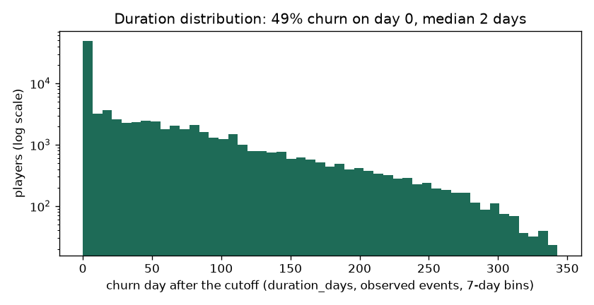
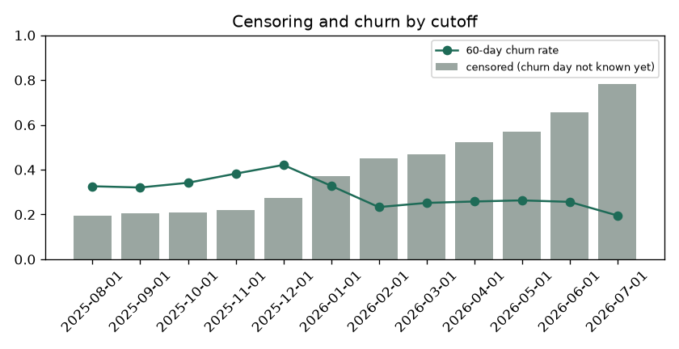

# EDA Summary vs Benchmark: Training Snapshot (brandId 64)

EDA stage 4 of the delivery plan: every statistic of the training snapshot next to its benchmark.

| | |
|---|---|
| Snapshot | `data/processed/churn90d/train_dataset_64_2025-08-01_2025-09-01_2025-10-01_2025-11-01_2025-12-01_2026-01-01_2026-02-01_2026-03-01_2026-04-01_2026-05-01_2026-06-01_2026-07-01_1792151122.parquet` |
| Benchmark | `none (first dataset)` (the previous dataset of the brand) |
| Status | 0 critical, 0 warn, 0 ok |

Thresholds: row counts and null shares as in `configs/eda_alerts.yaml` (row count +-20% warn, +-50% critical; null share +5 / +20 points; PSI 0.10 / 0.25); a label rate that moves more than 5 points is a warning. Medians are in real units (days, EUR, counts).

## 1. Snapshot, Labels and Durations

| metric | current | benchmark | delta | status |
|---|---|---|---|---|
| rows | 145,162 |  |  | new |
| players | 48,343 |  |  | new |
| cutoffs | 12 |  |  | new |
| rows_per_cutoff | 12,097 |  |  | new |
| churn_rate_60d | 0.313 |  |  | new |
| churn_within_7d_rate | 0.342 |  |  | new |
| churn_within_14d_rate | 0.372 |  |  | new |
| churn_within_30d_rate | 0.421 |  |  | new |
| event_rate | 0.640 |  |  | new |
| censoring_rate | 0.360 |  |  | new |
| duration_day0_share | 0.489 |  |  | new |
| duration_p50_days | 2 |  |  | new |
| duration_p75_days | 62 |  |  | new |
| duration_p90_days | 129 |  |  | new |
| duration_max_days | 341 |  |  | new |

## 2. Censoring and Duration Distribution

`duration_days` is the day the churn starts after the cutoff (0 = no bet in the next 60 days); a player is censored when the 60-day silence that would confirm it does not fit in the data yet. Censoring grows for recent cutoffs, which have less data after them.

| cutoff_date | rows | churn_rate_60d | churn_within_7d_rate | churn_within_14d_rate | churn_within_30d_rate | censoring_rate | median_churn_day |
|---|---|---|---|---|---|---|---|
| 2025-08-01 | 16299 | 0.326 | 0.351 | 0.375 | 0.410 | 0.196 | 26 |
| 2025-09-01 | 16417 | 0.320 | 0.347 | 0.365 | 0.409 | 0.205 | 26 |
| 2025-10-01 | 17059 | 0.341 | 0.374 | 0.396 | 0.462 | 0.209 | 14 |
| 2025-11-01 | 17318 | 0.382 | 0.429 | 0.475 | 0.551 | 0.218 | 2 |
| 2025-12-01 | 14615 | 0.421 | 0.444 | 0.459 | 0.502 | 0.273 | 0 |
| 2026-01-01 | 8978 | 0.328 | 0.351 | 0.364 | 0.397 | 0.372 | 0 |
| 2026-02-01 | 8740 | 0.233 | 0.258 | 0.284 | 0.324 | 0.452 | 13 |
| 2026-03-01 | 9675 | 0.252 | 0.280 | 0.301 | 0.346 | 0.470 | 4 |
| 2026-04-01 | 9457 | 0.258 | 0.283 | 0.305 | 0.351 | 0.521 | 0 |
| 2026-05-01 | 9546 | 0.263 | 0.293 | 0.312 | 0.365 | 0.570 | 0 |
| 2026-06-01 | 9087 | 0.256 | 0.281 | 0.297 | 0.330 | 0.657 | 0 |
| 2026-07-01 | 7971 | 0.196 | 0.218 | <NA> | <NA> | 0.782 | 0 |

## 3. Features

No feature flagged against the benchmark.

| feature | null share | null share, benchmark | median | PSI |
|---|---|---|---|---|
| days_since_last_bet | 0 |  | 7 |  |
| days_since_last_deposit | 0.752 |  | 8 |  |
| active_days_l7d | 0 |  | 0 |  |
| active_days_l30d | 0 |  | 3 |  |
| active_days_l90d | 0 |  | 9 |  |
| bets_l7d | 0 |  | 2 |  |
| bets_l30d | 0 |  | 912 |  |
| sessions_l7d | 0 |  | 1 |  |
| sessions_l30d | 0 |  | 5 |  |
| n_deposit_days_7d | 0.752 |  | 0 |  |
| n_deposit_days_30d | 0.752 |  | 2 |  |
| wagered_eur_l7d | 0 |  | 0.390 |  |
| wagered_eur_l30d | 0 |  | 436 |  |
| wagered_eur_l90d | 0 |  | 1,344 |  |
| net_loss_7d | 0 |  | 0 |  |
| ggr_eur_l30d | 0 |  | 37.356 |  |
| deposits_eur_l30d | 0.752 |  | 122 |  |
| withdrawals_30d_share | 0.773 |  | 0 |  |
| prior_wagered_eur_l7d | 0 |  | 5.515 |  |
| prior_active_days_l7d | 0 |  | 1 |  |
| prior_ggr_eur_l30d | 0 |  | 2.814 |  |
| wagered_trend_7 | 0 |  | 1 |  |
| heavy_loss_multiple | 0.169 |  | 0 |  |
| deposits_30_vs_prior30 | 0.879 |  | 0.933 |  |
| days_since_first_bet | 0 |  | 150 |  |
| prior_dormancy_spells_14d | 0 |  | 1 |  |
| days_since_last_return | 0 |  | 42 |  |
| engagement_score | 0 |  | 8.367 |  |
| games_breadth_30d | 0 |  | 4 |  |
| games_breadth_ratio | 0 |  | 1.500 |  |
| bonus_stake_share_30d | 0 |  | 0.057 |  |
| losing_streak | 0 |  | 3 |  |
| avg_bet_eur_l30d | 0 |  | 0.403 |  |
| night_play_index | 0 |  | 0 |  |
| deposited_within_3d | 0.752 |  | 0 |  |
| deposited_within_7d | 0.752 |  | 0 |  |
| deposited_within_14d | 0.752 |  | 1 |  |
| deposit_frequency_score | 0.752 |  | 0 |  |
| failed_deposits_14d | 0.752 |  | 0 |  |

Generated by `eda/summary.py` (`make eda-summary`; the pipeline runs it after building the dataset). Table: `data/03_output/eda_summary/brand64_churn90d/summary.csv`.
