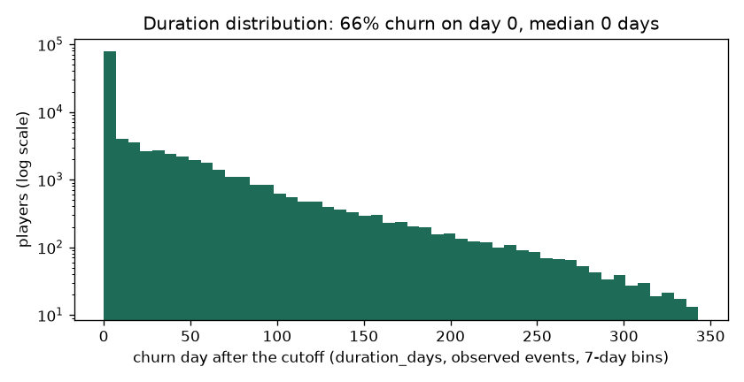
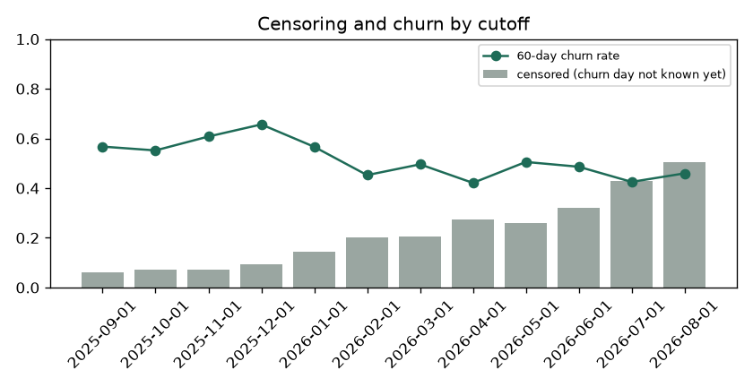

# EDA Summary vs Benchmark: Training Snapshot (brandId 72)

EDA stage 4 of the delivery plan: every statistic of the training snapshot next to its benchmark.

| | |
|---|---|
| Snapshot | `data/processed/train_dataset_72_2025-09-01_2025-10-01_2025-11-01_2025-12-01_2026-01-01_2026-02-01_2026-03-01_2026-04-01_2026-05-01_2026-06-01_2026-07-01_2026-08-01_1792128721.parquet` |
| Benchmark | `data/processed/train_dataset_72_2025-09-01_2025-10-01_2025-11-01_2025-12-01_2026-01-01_2026-02-01_2026-03-01_2026-04-01_2026-05-01_2026-06-01_2026-07-01_2026-08-01_1791546897.parquet` (the previous dataset of the brand) |
| Status | 6 critical, 17 warn, 64 ok |

Thresholds: row counts and null shares as in `configs/eda_alerts.yaml` (row count +-20% warn, +-50% critical; null share +5 / +20 points; PSI 0.10 / 0.25); a label rate that moves more than 5 points is a warning. Medians are in real units (days, EUR, counts).

## 1. Snapshot, Labels and Durations

| metric | current | benchmark | delta | status |
|---|---|---|---|---|
| rows | 138,269 | 218,525 | -80,256 | warn |
| players | 72,753 | 132,202 | -59,449 | warn |
| cutoffs | 12 | 12 | 0 | info |
| rows_per_cutoff | 11,522 | 18,210 | -6,688 | warn |
| churn_rate_60d | 0.531 | 0.619 | -0.088 | warn |
| churn_within_7d_rate | 0.579 | 0.662 | -0.084 | warn |
| churn_within_14d_rate | 0.610 | 0.688 | -0.079 | warn |
| churn_within_30d_rate | 0.663 | 0.735 | -0.072 | warn |
| event_rate | 0.804 | 0.850 | -0.046 | ok |
| censoring_rate | 0.196 | 0.150 | 0.046 | ok |
| duration_day0_share | 0.660 | 0.728 | -0.068 | info |
| duration_p50_days | 0 | 0 | 0 | info |
| duration_p75_days | 15 | 4 | 11 | info |
| duration_p90_days | 64 | 51 | 13 | info |
| duration_max_days | 340 | 340 | 0 | info |

## 2. Censoring and Duration Distribution

`duration_days` is the day the churn starts after the cutoff (0 = no bet in the next 60 days); a player is censored when the 60-day silence that would confirm it does not fit in the data yet. Censoring grows for recent cutoffs, which have less data after them.

| cutoff_date | rows | churn_rate_60d | churn_within_7d_rate | churn_within_14d_rate | churn_within_30d_rate | censoring_rate | median_churn_day |
|---|---|---|---|---|---|---|---|
| 2025-09-01 | 15856 | 0.567 | 0.608 | 0.643 | 0.692 | 0.061 | 0 |
| 2025-10-01 | 15458 | 0.552 | 0.596 | 0.629 | 0.691 | 0.071 | 0 |
| 2025-11-01 | 16183 | 0.608 | 0.665 | 0.707 | 0.781 | 0.074 | 0 |
| 2025-12-01 | 14709 | 0.656 | 0.692 | 0.716 | 0.753 | 0.093 | 0 |
| 2026-01-01 | 9381 | 0.566 | 0.605 | 0.630 | 0.676 | 0.143 | 0 |
| 2026-02-01 | 8366 | 0.452 | 0.500 | 0.532 | 0.586 | 0.203 | 0 |
| 2026-03-01 | 9969 | 0.496 | 0.535 | 0.562 | 0.611 | 0.207 | 0 |
| 2026-04-01 | 8485 | 0.421 | 0.466 | 0.492 | 0.549 | 0.275 | 0 |
| 2026-05-01 | 10530 | 0.505 | 0.545 | 0.575 | 0.625 | 0.258 | 0 |
| 2026-06-01 | 10036 | 0.486 | 0.518 | 0.546 | 0.591 | 0.320 | 0 |
| 2026-07-01 | 8989 | 0.425 | 0.464 | 0.494 | 0.549 | 0.430 | 0 |
| 2026-08-01 | 10307 | 0.459 | <NA> | <NA> | <NA> | 0.503 | 0 |

## 3. Features

Flagged against the benchmark:

| metric | current | benchmark | delta | status |
|---|---|---|---|---|
| null_share__heavy_loss_multiple | 0.168 | 0.117 | 0.051 | warn |
| psi__days_since_last_deposit | 0.446 | 0 | 0.446 | critical |
| psi__active_days_l7d | 5.462 | 0 | 5.462 | critical |
| psi__active_days_l30d | 0.523 | 0 | 0.523 | critical |
| psi__bets_l30d | 0.113 | 0 | 0.113 | warn |
| psi__sessions_l30d | 0.137 | 0 | 0.137 | warn |
| psi__n_deposit_days_30d | 0.541 | 0 | 0.541 | critical |
| psi__wagered_eur_l30d | 0.203 | 0 | 0.203 | warn |
| psi__wagered_eur_l90d | 0.218 | 0 | 0.218 | warn |
| psi__ggr_eur_l30d | 0.202 | 0 | 0.202 | warn |
| psi__deposits_eur_l30d | 0.246 | 0 | 0.246 | warn |
| psi__prior_active_days_l7d | 5.477 | 0 | 5.477 | critical |
| psi__engagement_score | 0.168 | 0 | 0.168 | warn |
| psi__games_breadth_30d | 0.120 | 0 | 0.120 | warn |
| psi__bonus_stake_share_30d | 0.385 | 0 | 0.385 | critical |
| psi__deposited_within_14d | 0.145 | 0 | 0.145 | warn |

| feature | null share | null share, benchmark | median | PSI |
|---|---|---|---|---|
| days_since_last_bet | 0 | 0 | 9 | 0.013 |
| days_since_last_deposit | 0.650 | 0.674 | 10 | 0.446 |
| active_days_l7d | 0 | 0 | 0 | 5.462 |
| active_days_l30d | 0 | 0 | 2 | 0.523 |
| active_days_l90d | 0 | 0 | 3 | 0.053 |
| bets_l7d | 0 | 0 | 0 | 0.034 |
| bets_l30d | 0 | 0 | 459 | 0.113 |
| sessions_l7d | 0 | 0 | 0 | 0.045 |
| sessions_l30d | 0 | 0 | 3 | 0.137 |
| n_deposit_days_7d | 0.650 | 0.674 | 0 | 0.076 |
| n_deposit_days_30d | 0.650 | 0.674 | 1 | 0.541 |
| wagered_eur_l7d | 0 | 0 | 0 | 0.042 |
| wagered_eur_l30d | 0 | 0 | 220 | 0.203 |
| wagered_eur_l90d | 0 | 0 | 456 | 0.218 |
| net_loss_7d | 0 | 0 | 0 | 0.046 |
| ggr_eur_l30d | 0 | 0 | 20.893 | 0.202 |
| deposits_eur_l30d | 0.650 | 0.674 | 30.250 | 0.246 |
| withdrawals_30d_share | 0.716 | 0.820 | 0 | 0.000 |
| prior_wagered_eur_l7d | 0 | 0 | 0 | 0.047 |
| prior_active_days_l7d | 0 | 0 | 0 | 5.477 |
| prior_ggr_eur_l30d | 0 | 0 | 0 | 0.059 |
| wagered_trend_7 | 0 | 0 | 1 | 0.022 |
| heavy_loss_multiple | 0.168 | 0.117 | 0 | 0.036 |
| deposits_30_vs_prior30 | 0.884 | 0.922 | 0.796 | 0.017 |
| days_since_first_bet | 0 | 0 | 47 | 0.033 |
| prior_dormancy_spells_14d | 0 | 0 | 0 | 0.015 |
| days_since_last_return | 0 | 0 | 181 | 0.018 |
| engagement_score | 0 | 0 | 5.054 | 0.168 |
| games_breadth_30d | 0 | 0 | 4 | 0.120 |
| games_breadth_ratio | 0 | 0 | 2 | 0.089 |
| bonus_stake_share_30d | 0 | 0.000 | 0.043 | 0.385 |
| losing_streak | 0 | 0 | 2 | 0.083 |
| avg_bet_eur_l30d | 0 | 0 | 0.450 | 0.043 |
| night_play_index | 0 | 0 | 0 | 0 |
| deposited_within_3d | 0.650 | 0.674 | 0 | 0.041 |
| deposited_within_7d | 0.650 | 0.674 | 0 | 0.076 |
| deposited_within_14d | 0.650 | 0.674 | 1 | 0.145 |
| deposit_frequency_score | 0.650 | 0.674 | 0 | 0.049 |
| failed_deposits_14d | 0.650 | 0.674 | 0 | 0.054 |

Generated by `eda/summary.py` (`make eda-summary`; the pipeline runs it after building the dataset). Table: `data/03_output/eda_summary/brand72/summary.csv`.
