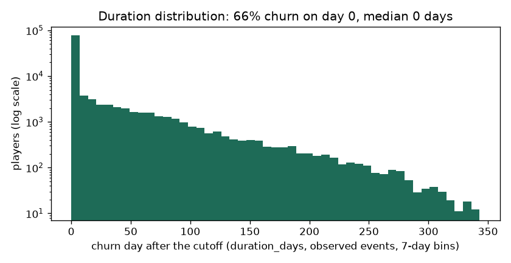
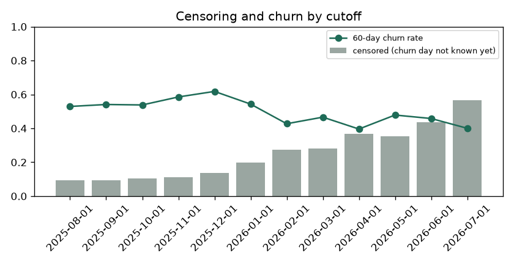

# EDA Summary vs Benchmark: Training Snapshot (brandId 72)

EDA stage 4 of the delivery plan: every statistic of the training snapshot next to its benchmark.

| | |
|---|---|
| Snapshot | `data/processed/churn90d/train_dataset_72_2025-08-01_2025-09-01_2025-10-01_2025-11-01_2025-12-01_2026-01-01_2026-02-01_2026-03-01_2026-04-01_2026-05-01_2026-06-01_2026-07-01_1792152794.parquet` |
| Benchmark | `none (first dataset)` (the previous dataset of the brand) |
| Status | 0 critical, 0 warn, 0 ok |

Thresholds: row counts and null shares as in `configs/eda_alerts.yaml` (row count +-20% warn, +-50% critical; null share +5 / +20 points; PSI 0.10 / 0.25); a label rate that moves more than 5 points is a warning. Medians are in real units (days, EUR, counts).

## 1. Snapshot, Labels and Durations

| metric | current | benchmark | delta | status |
|---|---|---|---|---|
| rows | 142,155 |  |  | new |
| players | 75,649 |  |  | new |
| cutoffs | 12 |  |  | new |
| rows_per_cutoff | 11,846 |  |  | new |
| churn_rate_60d | 0.513 |  |  | new |
| churn_within_7d_rate | 0.551 |  |  | new |
| churn_within_14d_rate | 0.585 |  |  | new |
| churn_within_30d_rate | 0.630 |  |  | new |
| event_rate | 0.778 |  |  | new |
| censoring_rate | 0.222 |  |  | new |
| duration_day0_share | 0.659 |  |  | new |
| duration_p50_days | 0 |  |  | new |
| duration_p75_days | 17 |  |  | new |
| duration_p90_days | 78 |  |  | new |
| duration_max_days | 341 |  |  | new |

## 2. Censoring and Duration Distribution

`duration_days` is the day the churn starts after the cutoff (0 = no bet in the next 60 days); a player is censored when the 60-day silence that would confirm it does not fit in the data yet. Censoring grows for recent cutoffs, which have less data after them.

| cutoff_date | rows | churn_rate_60d | churn_within_7d_rate | churn_within_14d_rate | churn_within_30d_rate | censoring_rate | median_churn_day |
|---|---|---|---|---|---|---|---|
| 2025-08-01 | 14193 | 0.529 | 0.572 | 0.596 | 0.635 | 0.092 | 0 |
| 2025-09-01 | 15856 | 0.541 | 0.578 | 0.610 | 0.655 | 0.092 | 0 |
| 2025-10-01 | 15458 | 0.538 | 0.580 | 0.610 | 0.666 | 0.106 | 0 |
| 2025-11-01 | 16183 | 0.585 | 0.636 | 0.672 | 0.730 | 0.113 | 0 |
| 2025-12-01 | 14709 | 0.618 | 0.649 | 0.670 | 0.702 | 0.138 | 0 |
| 2026-01-01 | 9381 | 0.543 | 0.578 | 0.599 | 0.640 | 0.197 | 0 |
| 2026-02-01 | 8366 | 0.427 | 0.469 | 0.497 | 0.543 | 0.273 | 0 |
| 2026-03-01 | 9969 | 0.466 | 0.500 | 0.523 | 0.565 | 0.280 | 0 |
| 2026-04-01 | 8485 | 0.396 | 0.434 | 0.457 | 0.507 | 0.368 | 0 |
| 2026-05-01 | 10530 | 0.479 | 0.514 | 0.540 | 0.581 | 0.354 | 0 |
| 2026-06-01 | 10036 | 0.458 | 0.485 | 0.509 | 0.547 | 0.437 | 0 |
| 2026-07-01 | 8989 | 0.400 | 0.435 | <NA> | <NA> | 0.565 | 0 |

## 3. Features

No feature flagged against the benchmark.

| feature | null share | null share, benchmark | median | PSI |
|---|---|---|---|---|
| days_since_last_bet | 0 |  | 10 |  |
| days_since_last_deposit | 0.732 |  | 10 |  |
| active_days_l7d | 0 |  | 0 |  |
| active_days_l30d | 0 |  | 2 |  |
| active_days_l90d | 0 |  | 3 |  |
| bets_l7d | 0 |  | 0 |  |
| bets_l30d | 0 |  | 413 |  |
| sessions_l7d | 0 |  | 0 |  |
| sessions_l30d | 0 |  | 3 |  |
| n_deposit_days_7d | 0.732 |  | 0 |  |
| n_deposit_days_30d | 0.732 |  | 1 |  |
| wagered_eur_l7d | 0 |  | 0 |  |
| wagered_eur_l30d | 0 |  | 198 |  |
| wagered_eur_l90d | 0 |  | 400 |  |
| net_loss_7d | 0 |  | 0 |  |
| ggr_eur_l30d | 0 |  | 20 |  |
| deposits_eur_l30d | 0.732 |  | 35.148 |  |
| withdrawals_30d_share | 0.779 |  | 0 |  |
| prior_wagered_eur_l7d | 0 |  | 0 |  |
| prior_active_days_l7d | 0 |  | 0 |  |
| prior_ggr_eur_l30d | 0 |  | 0 |  |
| wagered_trend_7 | 0 |  | 1 |  |
| heavy_loss_multiple | 0.170 |  | 0 |  |
| deposits_30_vs_prior30 | 0.919 |  | 0.982 |  |
| days_since_first_bet | 0 |  | 41 |  |
| prior_dormancy_spells_14d | 0 |  | 0 |  |
| days_since_last_return | 0 |  | 181 |  |
| engagement_score | 0 |  | 4.741 |  |
| games_breadth_30d | 0 |  | 4 |  |
| games_breadth_ratio | 0 |  | 2 |  |
| bonus_stake_share_30d | 0 |  | 0.038 |  |
| losing_streak | 0 |  | 2 |  |
| avg_bet_eur_l30d | 0 |  | 0.454 |  |
| night_play_index | 0 |  | 0 |  |
| deposited_within_3d | 0.732 |  | 0 |  |
| deposited_within_7d | 0.732 |  | 0 |  |
| deposited_within_14d | 0.732 |  | 1 |  |
| deposit_frequency_score | 0.732 |  | 0 |  |
| failed_deposits_14d | 0.732 |  | 0 |  |

Generated by `eda/summary.py` (`make eda-summary`; the pipeline runs it after building the dataset). Table: `data/03_output/eda_summary/brand72_churn90d/summary.csv`.
