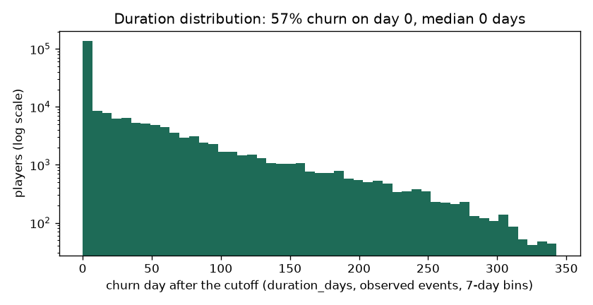
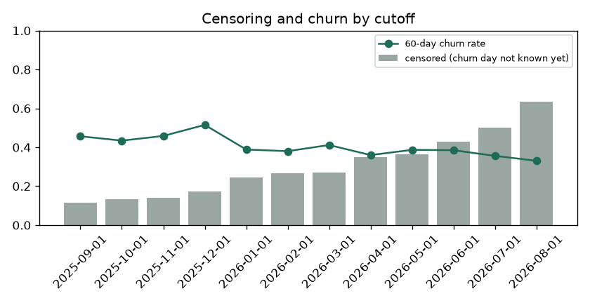

# EDA Summary vs Benchmark: Training Snapshot (brandId 73)

EDA stage 4 of the delivery plan: every statistic of the training snapshot next to its benchmark.

| | |
|---|---|
| Snapshot | `data/processed/train_dataset_73_2025-09-01_2025-10-01_2025-11-01_2025-12-01_2026-01-01_2026-02-01_2026-03-01_2026-04-01_2026-05-01_2026-06-01_2026-07-01_2026-08-01_1792129093.parquet` |
| Benchmark | `data/processed/train_dataset_73_2025-09-01_2025-10-01_2025-11-01_2025-12-01_2026-01-01_2026-02-01_2026-03-01_2026-04-01_2026-05-01_2026-06-01_2026-07-01_2026-08-01_1791434475.parquet` (the previous dataset of the brand) |
| Status | 5 critical, 3 warn, 76 ok |

Thresholds: row counts and null shares as in `configs/eda_alerts.yaml` (row count +-20% warn, +-50% critical; null share +5 / +20 points; PSI 0.10 / 0.25); a label rate that moves more than 5 points is a warning. Medians are in real units (days, EUR, counts).

## 1. Snapshot, Labels and Durations

| metric | current | benchmark | delta | status |
|---|---|---|---|---|
| rows | 303,917 | 372,447 | -68,530 | ok |
| players | 125,981 | 161,494 | -35,513 | warn |
| cutoffs | 12 | 12 | 0 | info |
| rows_per_cutoff | 25,326 | 31,037 | -5,711 | ok |
| churn_rate_60d | 0.415 | 0.438 | -0.023 | ok |
| churn_within_7d_rate | 0.461 |  |  | new |
| churn_within_14d_rate | 0.490 |  |  | new |
| churn_within_30d_rate | 0.545 |  |  | new |
| event_rate | 0.725 | 0.740 | -0.015 | ok |
| censoring_rate | 0.275 | 0.260 | 0.015 | ok |
| duration_day0_share | 0.572 | 0.592 | -0.020 | info |
| duration_p50_days | 0 | 0 | 0 | info |
| duration_p75_days | 34 | 32 | 2 | info |
| duration_p90_days | 93 | 92 | 1 | info |
| duration_max_days | 340 | 340 | 0 | info |

## 2. Censoring and Duration Distribution

`duration_days` is the day the churn starts after the cutoff (0 = no bet in the next 60 days); a player is censored when the 60-day silence that would confirm it does not fit in the data yet. Censoring grows for recent cutoffs, which have less data after them.

| cutoff_date | rows | churn_rate_60d | churn_within_7d_rate | churn_within_14d_rate | churn_within_30d_rate | censoring_rate | median_churn_day |
|---|---|---|---|---|---|---|---|
| 2025-09-01 | 36305 | 0.457 | 0.498 | 0.525 | 0.577 | 0.116 | 0 |
| 2025-10-01 | 33579 | 0.434 | 0.475 | 0.503 | 0.561 | 0.133 | 0 |
| 2025-11-01 | 33229 | 0.459 | 0.511 | 0.557 | 0.648 | 0.142 | 0 |
| 2025-12-01 | 29815 | 0.515 | 0.550 | 0.571 | 0.613 | 0.174 | 0 |
| 2026-01-01 | 20395 | 0.389 | 0.422 | 0.445 | 0.495 | 0.246 | 0 |
| 2026-02-01 | 21728 | 0.380 | 0.421 | 0.452 | 0.505 | 0.268 | 0 |
| 2026-03-01 | 24222 | 0.412 | 0.451 | 0.479 | 0.532 | 0.272 | 0 |
| 2026-04-01 | 20472 | 0.360 | 0.397 | 0.424 | 0.477 | 0.348 | 0 |
| 2026-05-01 | 21925 | 0.387 | 0.431 | 0.458 | 0.506 | 0.364 | 0 |
| 2026-06-01 | 21001 | 0.385 | 0.418 | 0.445 | 0.491 | 0.428 | 0 |
| 2026-07-01 | 21212 | 0.356 | 0.394 | 0.424 | 0.477 | 0.503 | 0 |
| 2026-08-01 | 20034 | 0.331 | <NA> | <NA> | <NA> | 0.635 | 0 |

## 3. Features

Flagged against the benchmark:

| metric | current | benchmark | delta | status |
|---|---|---|---|---|
| psi__days_since_last_deposit | 0.143 | 0 | 0.143 | warn |
| psi__active_days_l7d | 6.897 | 0 | 6.897 | critical |
| psi__active_days_l30d | 2.989 | 0 | 2.989 | critical |
| psi__active_days_l90d | 1.787 | 0 | 1.787 | critical |
| psi__n_deposit_days_30d | 0.244 | 0 | 0.244 | warn |
| psi__prior_active_days_l7d | 6.514 | 0 | 6.514 | critical |
| psi__bonus_stake_share_30d | 0.319 | 0 | 0.319 | critical |

| feature | null share | null share, benchmark | median | PSI |
|---|---|---|---|---|
| days_since_last_bet | 0 | 0 | 7 | 0.005 |
| days_since_last_deposit | 0.656 | 0.655 | 8 | 0.143 |
| active_days_l7d | 0 | 0 | 0 | 6.897 |
| active_days_l30d | 0 | 0 | 3 | 2.989 |
| active_days_l90d | 0 | 0 | 6 | 1.787 |
| bets_l7d | 0 | 0 | 4 | 0.009 |
| bets_l30d | 0 | 0 | 446 | 0.028 |
| sessions_l7d | 0 | 0 | 1 | 0.014 |
| sessions_l30d | 0 | 0 | 5 | 0.038 |
| n_deposit_days_7d | 0.656 | 0.655 | 0 | 0.030 |
| n_deposit_days_30d | 0.656 | 0.655 | 2 | 0.244 |
| wagered_eur_l7d | 0 | 0 | 4.997 | 0.017 |
| wagered_eur_l30d | 0 | 0 | 340 | 0.078 |
| wagered_eur_l90d | 0 | 0 | 915 | 0.057 |
| net_loss_7d | 0 | 0 | 0 | 0.016 |
| ggr_eur_l30d | 0 | 0 | 33.960 | 0.060 |
| deposits_eur_l30d | 0.656 | 0.655 | 37.377 | 0.052 |
| withdrawals_30d_share | 0.749 | 0.795 | 0 | 0.000 |
| prior_wagered_eur_l7d | 0 | 0 | 2.841 | 0.018 |
| prior_active_days_l7d | 0 | 0 | 0 | 6.514 |
| prior_ggr_eur_l30d | 0 | 0 | 0 | 0.015 |
| wagered_trend_7 | 0 | 0 | 1 | 0.008 |
| heavy_loss_multiple | 0.151 | 0.144 | 0 | 0.007 |
| deposits_30_vs_prior30 | 0.879 | 0.897 | 0.730 | 0.007 |
| days_since_first_bet | 0 | 0 | 142 | 0.002 |
| prior_dormancy_spells_14d | 0 | 0 | 1 | 0.002 |
| days_since_last_return | 0 | 0 | 94 | 0.005 |
| engagement_score | 0 | 0 | 8.681 | 0.038 |
| games_breadth_30d | 0 | 0 | 4 | 0.031 |
| games_breadth_ratio | 0 | 0 | 1.857 | 0.016 |
| bonus_stake_share_30d | 0.000 | 0.016 | 0.032 | 0.319 |
| losing_streak | 0 | 0 | 2 | 0.007 |
| avg_bet_eur_l30d | 0 | 0 | 0.744 | 0.037 |
| night_play_index | 0 | 0 | 0 | 0 |
| deposited_within_3d | 0.656 | 0.655 | 0 | 0.016 |
| deposited_within_7d | 0.656 | 0.655 | 0 | 0.030 |
| deposited_within_14d | 0.656 | 0.655 | 1 | 0.058 |
| deposit_frequency_score | 0.656 | 0.655 | 0 | 0.012 |
| failed_deposits_14d | 0.656 | 0.655 | 0 | 0.017 |

Generated by `eda/summary.py` (`make eda-summary`; the pipeline runs it after building the dataset). Table: `data/03_output/eda_summary/brand73/summary.csv`.
