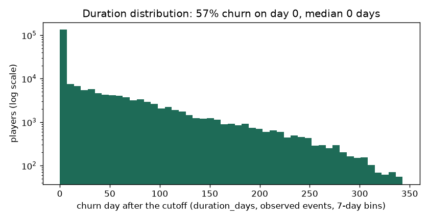
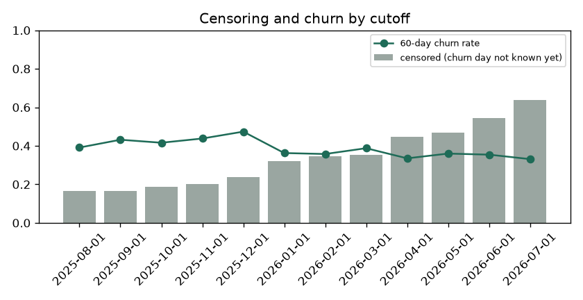

# EDA Summary vs Benchmark: Training Snapshot (brandId 73)

EDA stage 4 of the delivery plan: every statistic of the training snapshot next to its benchmark.

| | |
|---|---|
| Snapshot | `data/processed/churn90d/train_dataset_73_2025-08-01_2025-09-01_2025-10-01_2025-11-01_2025-12-01_2026-01-01_2026-02-01_2026-03-01_2026-04-01_2026-05-01_2026-06-01_2026-07-01_1792153176.parquet` |
| Benchmark | `none (first dataset)` (the previous dataset of the brand) |
| Status | 0 critical, 0 warn, 0 ok |

Thresholds: row counts and null shares as in `configs/eda_alerts.yaml` (row count +-20% warn, +-50% critical; null share +5 / +20 points; PSI 0.10 / 0.25); a label rate that moves more than 5 points is a warning. Medians are in real units (days, EUR, counts).

## 1. Snapshot, Labels and Durations

| metric | current | benchmark | delta | status |
|---|---|---|---|---|
| rows | 316,890 |  |  | new |
| players | 133,466 |  |  | new |
| cutoffs | 12 |  |  | new |
| rows_per_cutoff | 26,408 |  |  | new |
| churn_rate_60d | 0.395 |  |  | new |
| churn_within_7d_rate | 0.429 |  |  | new |
| churn_within_14d_rate | 0.459 |  |  | new |
| churn_within_30d_rate | 0.505 |  |  | new |
| event_rate | 0.689 |  |  | new |
| censoring_rate | 0.311 |  |  | new |
| duration_day0_share | 0.573 |  |  | new |
| duration_p50_days | 0 |  |  | new |
| duration_p75_days | 40 |  |  | new |
| duration_p90_days | 108 |  |  | new |
| duration_max_days | 341 |  |  | new |

## 2. Censoring and Duration Distribution

`duration_days` is the day the churn starts after the cutoff (0 = no bet in the next 60 days); a player is censored when the 60-day silence that would confirm it does not fit in the data yet. Censoring grows for recent cutoffs, which have less data after them.

| cutoff_date | rows | churn_rate_60d | churn_within_7d_rate | churn_within_14d_rate | churn_within_30d_rate | censoring_rate | median_churn_day |
|---|---|---|---|---|---|---|---|
| 2025-08-01 | 33007 | 0.391 | 0.426 | 0.450 | 0.499 | 0.167 | 5 |
| 2025-09-01 | 36305 | 0.432 | 0.467 | 0.491 | 0.537 | 0.164 | 0 |
| 2025-10-01 | 33579 | 0.416 | 0.453 | 0.479 | 0.529 | 0.187 | 0 |
| 2025-11-01 | 33229 | 0.438 | 0.485 | 0.523 | 0.593 | 0.202 | 0 |
| 2025-12-01 | 29815 | 0.474 | 0.502 | 0.520 | 0.555 | 0.238 | 0 |
| 2026-01-01 | 20395 | 0.363 | 0.393 | 0.413 | 0.454 | 0.322 | 0 |
| 2026-02-01 | 21728 | 0.358 | 0.393 | 0.420 | 0.464 | 0.347 | 0 |
| 2026-03-01 | 24222 | 0.388 | 0.423 | 0.447 | 0.490 | 0.354 | 0 |
| 2026-04-01 | 20472 | 0.335 | 0.366 | 0.387 | 0.430 | 0.447 | 0 |
| 2026-05-01 | 21925 | 0.360 | 0.398 | 0.420 | 0.460 | 0.468 | 0 |
| 2026-06-01 | 21001 | 0.354 | 0.382 | 0.404 | 0.441 | 0.545 | 0 |
| 2026-07-01 | 21212 | 0.331 | 0.363 | <NA> | <NA> | 0.637 | 0 |

## 3. Features

No feature flagged against the benchmark.

| feature | null share | null share, benchmark | median | PSI |
|---|---|---|---|---|
| days_since_last_bet | 0 |  | 7 |  |
| days_since_last_deposit | 0.733 |  | 8 |  |
| active_days_l7d | 0 |  | 0 |  |
| active_days_l30d | 0 |  | 3 |  |
| active_days_l90d | 0 |  | 6 |  |
| bets_l7d | 0 |  | 4 |  |
| bets_l30d | 0 |  | 431 |  |
| sessions_l7d | 0 |  | 1 |  |
| sessions_l30d | 0 |  | 5 |  |
| n_deposit_days_7d | 0.733 |  | 0 |  |
| n_deposit_days_30d | 0.733 |  | 2 |  |
| wagered_eur_l7d | 0 |  | 4.202 |  |
| wagered_eur_l30d | 0 |  | 317 |  |
| wagered_eur_l90d | 0 |  | 834 |  |
| net_loss_7d | 0 |  | 0 |  |
| ggr_eur_l30d | 0 |  | 30.199 |  |
| deposits_eur_l30d | 0.733 |  | 37.775 |  |
| withdrawals_30d_share | 0.800 |  | 0 |  |
| prior_wagered_eur_l7d | 0 |  | 2.265 |  |
| prior_active_days_l7d | 0 |  | 0 |  |
| prior_ggr_eur_l30d | 0 |  | 0 |  |
| wagered_trend_7 | 0 |  | 1 |  |
| heavy_loss_multiple | 0.156 |  | 0 |  |
| deposits_30_vs_prior30 | 0.921 |  | 0.997 |  |
| days_since_first_bet | 0 |  | 118 |  |
| prior_dormancy_spells_14d | 0 |  | 1 |  |
| days_since_last_return | 0 |  | 113 |  |
| engagement_score | 0 |  | 8.250 |  |
| games_breadth_30d | 0 |  | 4 |  |
| games_breadth_ratio | 0 |  | 2 |  |
| bonus_stake_share_30d | 0.000 |  | 0.030 |  |
| losing_streak | 0 |  | 2 |  |
| avg_bet_eur_l30d | 0 |  | 0.704 |  |
| night_play_index | 0 |  | 0 |  |
| deposited_within_3d | 0.733 |  | 0 |  |
| deposited_within_7d | 0.733 |  | 0 |  |
| deposited_within_14d | 0.733 |  | 1 |  |
| deposit_frequency_score | 0.733 |  | 0 |  |
| failed_deposits_14d | 0.733 |  | 0 |  |

Generated by `eda/summary.py` (`make eda-summary`; the pipeline runs it after building the dataset). Table: `data/03_output/eda_summary/brand73_churn90d/summary.csv`.
