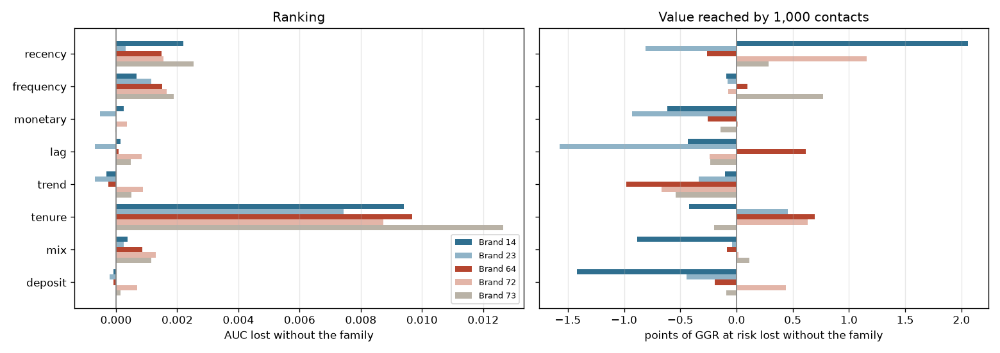

# Feature Family Ablation

For each brand, the reference LightGBM is trained on all the features of its registered dataset and then again without each family (same split, parameters and early stopping). Test months of the registered model; probabilities calibrated on the validation month (isotonic); GGR at risk reached by 1,000 contacts per month ranked by value at risk. A negative delta for AUC or GGR (positive for log-loss or ECE) means the family helps. Generated by `src/models/ablation_full.py` (`make ablation`).

## Brand 14

All features: AUC 0.8996, log-loss 0.3903, ECE 0.0144, GGR at risk reached 87.1%.

| removed family | features | AUC delta | log-loss delta | ECE delta | GGR reached delta (points) |
|---|---|---|---|---|---|
| recency | 2 | -0.0022 | +0.0064 | -0.0004 | -2.06 |
| frequency | 9 | -0.0007 | +0.0025 | +0.0017 | +0.09 |
| monetary | 7 | -0.0002 | +0.0028 | -0.0015 | +0.61 |
| lag | 3 | -0.0001 | +0.0030 | +0.0008 | +0.43 |
| trend | 3 | +0.0003 | +0.0032 | -0.0000 | +0.10 |
| tenure | 3 | -0.0094 | +0.0098 | -0.0004 | +0.42 |
| mix | 7 | -0.0004 | +0.0000 | +0.0002 | +0.88 |
| deposit | 5 | +0.0001 | +0.0006 | -0.0006 | +1.42 |

## Brand 23

All features: AUC 0.9019, log-loss 0.2879, ECE 0.0198, GGR at risk reached 65.4%.

| removed family | features | AUC delta | log-loss delta | ECE delta | GGR reached delta (points) |
|---|---|---|---|---|---|
| recency | 2 | -0.0003 | +0.0011 | +0.0008 | +0.81 |
| frequency | 9 | -0.0012 | +0.0014 | -0.0014 | +0.08 |
| monetary | 7 | +0.0005 | -0.0003 | +0.0003 | +0.93 |
| lag | 3 | +0.0007 | -0.0005 | -0.0007 | +1.58 |
| trend | 3 | +0.0007 | -0.0009 | -0.0008 | +0.34 |
| tenure | 3 | -0.0074 | +0.0119 | +0.0035 | -0.45 |
| mix | 7 | -0.0002 | +0.0002 | -0.0008 | +0.04 |
| deposit | 5 | +0.0002 | +0.0002 | -0.0003 | +0.45 |

## Brand 64

All features: AUC 0.8922, log-loss 0.3744, ECE 0.0302, GGR at risk reached 68.3%.

| removed family | features | AUC delta | log-loss delta | ECE delta | GGR reached delta (points) |
|---|---|---|---|---|---|
| recency | 2 | -0.0015 | +0.0036 | +0.0021 | +0.26 |
| frequency | 9 | -0.0015 | +0.0008 | +0.0004 | -0.10 |
| monetary | 7 | -0.0000 | +0.0018 | -0.0007 | +0.25 |
| lag | 3 | -0.0001 | -0.0012 | -0.0005 | -0.62 |
| trend | 3 | +0.0002 | -0.0001 | -0.0008 | +0.98 |
| tenure | 3 | -0.0097 | +0.0144 | -0.0048 | -0.70 |
| mix | 7 | -0.0009 | -0.0011 | -0.0018 | +0.08 |
| deposit | 5 | +0.0001 | -0.0019 | -0.0005 | +0.19 |

## Brand 72

All features: AUC 0.8842, log-loss 0.4258, ECE 0.0157, GGR at risk reached 74.7%.

| removed family | features | AUC delta | log-loss delta | ECE delta | GGR reached delta (points) |
|---|---|---|---|---|---|
| recency | 2 | -0.0015 | +0.0015 | -0.0008 | -1.16 |
| frequency | 9 | -0.0016 | +0.0018 | -0.0021 | +0.08 |
| monetary | 7 | -0.0004 | -0.0011 | +0.0002 | -0.01 |
| lag | 3 | -0.0008 | +0.0003 | +0.0014 | +0.24 |
| trend | 3 | -0.0009 | +0.0008 | -0.0004 | +0.67 |
| tenure | 3 | -0.0087 | +0.0124 | +0.0056 | -0.63 |
| mix | 7 | -0.0013 | +0.0004 | +0.0052 | -0.02 |
| deposit | 5 | -0.0007 | -0.0003 | +0.0005 | -0.44 |

## Brand 73

All features: AUC 0.8973, log-loss 0.3829, ECE 0.0146, GGR at risk reached 62.4%.

| removed family | features | AUC delta | log-loss delta | ECE delta | GGR reached delta (points) |
|---|---|---|---|---|---|
| recency | 2 | -0.0025 | +0.0044 | +0.0014 | -0.29 |
| frequency | 9 | -0.0019 | +0.0042 | +0.0008 | -0.77 |
| monetary | 7 | +0.0000 | +0.0007 | +0.0009 | +0.14 |
| lag | 3 | -0.0005 | +0.0012 | -0.0014 | +0.23 |
| trend | 3 | -0.0005 | +0.0011 | -0.0005 | +0.54 |
| tenure | 3 | -0.0127 | +0.0209 | +0.0026 | +0.20 |
| mix | 7 | -0.0011 | +0.0018 | -0.0001 | -0.11 |
| deposit | 5 | -0.0001 | +0.0006 | +0.0004 | +0.09 |

